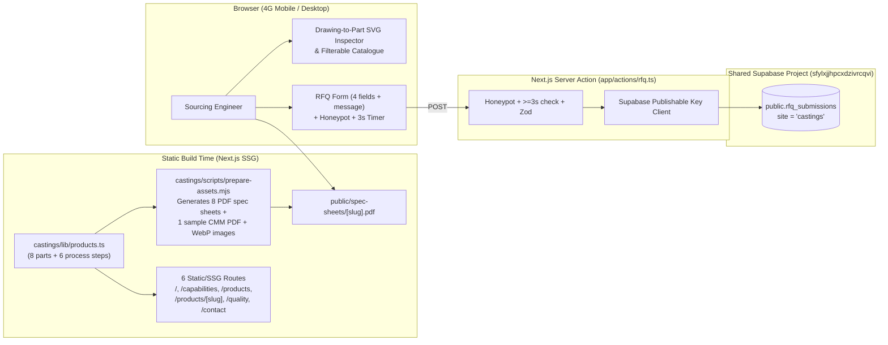

# Demo 2 Plan — Precision Castings & Machined Components (`castings/`)

**Status:** Awaiting User Approval  
**Fiverr Package Mapping:** Standard Package + per-product build-time PDF spec sheets  
**Target Buyers:** OEM procurement managers, sourcing engineers, and industrial distributors in **Germany** (Stuttgart, Munich, Hamburg) and the **USA** (Midwest / Great Lakes, Houston).  
**Tone:** Precise · engineered · no-nonsense.

---

## 1. Content Diet & Integrity Rules (Strictly Enforced)

- **Goal:** Showcase design and build capability, not product expertise. Let imagery and one motion moment carry each section.
- **Max ~40 words of body text per section.**
- **One headline per section.**
- **Max one number per section**, marked with a dagger (`†`) and explained once in the footer (`† All figures, tolerances, capacities and lead times shown are sample figures.`).
- **No standards, test methods or long spec tables** in body copy (no ASTM/EN/DIN strings, ISO numbers, or NDT test codes).
- **Product detail pages get at most a 4-row table:** `Material`, `Weight`, `MOQ`, `Lead time` + `"Download spec sheet (PDF)"` + `"Request a quote"` button.
- **Footer on every page:** `Concept design — fictional company. Website by Rajiv Dudeja.`
- **`<meta name="robots" content="noindex">` on every page.**

---

## 2. Proposed Fictional Company Names (Choose 1)

Per [briefs/castings.md](file:///c:/Users/dudej/Projects/website-demos/briefs/castings.md), please approve **one** of these three invented names:

1. **Aakarshan Metallurgy & CNC** *(Rajkot, Gujarat — "Aakarshan" evokes precision forming; authentic to a Rajkot GIDC Metoda engineering export unit)* — **(Recommended)**
2. **Saurashtra Alloy & Precision Cast** *(Region-anchored, industrial, signals foundry + CNC capability in Gujarat's casting belt)*
3. **Kinesis Cast & Machine Works** *(Technical, export-oriented industrial marque)*

---

## 3. Visual Identity & Design System

| Token | Specification | Usage |
|---|---|---|
| **Display & Heading Font** | **Archivo** (`next/font/google`, variable `wdth` axis `115–125` for expanded technical headings, weights 600–700) | H1–H2, section headlines, large numerals |
| **Technical & Spec Font** | **IBM Plex Mono** (`next/font/google`, weights 400, 500, 600, `tabular-nums`) | Callouts, 4-row product tables, coordinates, step indices |
| **Body Font** | **Archivo** (weight 400, 500, normal width 100) | Concise ≤40-word section copy, navigation, form controls |
| **Primary Dark (`graphite`)** | `#14171A` | Primary surface for Hero, Drawing-to-Part Inspector, Process Line, Footer |
| **Elevated Dark (`graphite-light`)** | `#1C2126` | Technical callout chips, dark cards |
| **Neutral Mid (`steel`)** | `#8A949C` | Secondary labels, thin `1px` CAD hairlines, dimension ticks |
| **Light Surface (`paper`)** | `#ECEEF0` | Daylight engineering-sheet sections (Components showcase, Quality, Quote band) |
| **Single Accent (`molten`)** | `#FF5A1F` (Molten Orange) | Primary RFQ CTAs, active SVG dimension leaders, progress bar, focus rings |

---

## 4. Sitemap & Every Section's Single Job (6 Pages)

All public routes are statically generated (`SSG`) at build time. Consecutive sections alternate layout and surface (`graphite #14171A` vs `paper #ECEEF0`) with thin `1px` CAD registration hairlines.

### Page 1: Home (`/`) — 6 Focused Sections
1. **Hero (`#site-hero`, dark `graphite`)** — *One job:* Full-bleed macro photograph of a precision-machined stainless valve body on dark graphite.
   - **H1:** *"Cast in Rajkot. Machined for Stuttgart."*
   - **Body (22 words):** *"Lost-wax investment castings and five-axis CNC components delivered ready for assembly to German and North American OEM lines."* (0 numbers).
   - **CTA:** Single molten-orange button `"Request a quote"` (plus sticky mobile bottom bar with `"Request a quote"` + `"WhatsApp"` after scrolling past the hero).
2. **Signature Moment: "Drawing to Part" Inspector (`#drawing-inspector`, dark `graphite-light`)** — *One job:* Overlay an interactive SVG orthographic technical drawing (dimension arrows, datum crosshairs, and 4 interactive callout nodes) that draws in on scroll over the physical valve body photograph.
   - **Headline:** *"From print to finished bore."*
   - **Body (24 words):** *"Hover or tap any datum callout to inspect how our foundry and five-axis machining centres hold critical sealing surfaces to ±0.03 mm†."* (1 number: `±0.03 mm†`).
   - **4 Callout Badges (hover/tap highlights region on SVG):** `316 Stainless` · `Bore ±0.03 mm†` · `Mirror Seat` · `5-Axis Milled`.
   - *3D Decision:* Skip React Three Fiber (`Three.js`) — the crisp macro photograph + interactive SVG CAD overlay is faster (`0 KB` 3D runtime) and looks authentically like an engineering print.
3. **Components Showcase (`#components`, light `paper`)** — *One job:* Present the 8 export components cleanly without clutter.
   - **Headline:** *"Eight† core export geometries."*
   - **Body (20 words):** *"Valve bodies, impellers, flanges and structural brackets poured in stainless steel, carbon steel, ductile iron and aluminium."* (1 number: `Eight†` in headline).
   - **Layout:** Clean technical index grid with large part photography, part name, and process tag (`Investment Cast + CNC`, `Sand Cast + CNC`, `Precision Turned`).
4. **Supporting Moment: Horizontal "Process Line" (`#process-line`, dark `graphite`, pinned on desktop)** — *One job:* Walk the buyer through the 6-stage single-site workflow (`01 Pattern` → `02 Shell` → `03 Pour` → `04 Machine` → `05 Inspect` → `06 Pack`) with a molten-orange progress bar.
   - **Headline:** *"One roof from wax to crate."*
   - **Each Panel:** Full-bleed industrial photo, large mono step index (`01`–`06`), stage title, and one short ≤12-word line. Pinned via an inner wrapper `
` inside `<section>` so Next.js client navigation never conflicts with GSAP's `pin-spacer`.
5. **Quality Snapshot (`#quality`, light `paper`)** — *One job:* Communicate inspection confidence visually without standard codes.
   - **Headline:** *"Verified before every pour and pack."*
   - **Body (24 words):** *"Every production heat is checked on our optical spectrometer and coordinate-measured on a bridge CMM with 100%† lot traceability to Mundra port."* (1 number: `100%†`).
   - **3 Labels + Large CMM Macro Photo:** `Spectro-verified` · `CMM-probed` · `Seaworthy VCI-packed`.
6. **Quote Form (`#quote`, dark `graphite`)** — *One job:* Convert the engineer in ≤5 fields.
   - **Headline:** *"Send your part requirement."*
   - **Body (18 words):** *"We reply within 24† hours with unit price, tooling timeline and FOB Mundra or CIF Hamburg freight."* (1 number: `24†`).
   - **Form (4 visible fields + optional message + honeypot + 3s timer):** Name, Business email, Country, Product & quantity (placeholder: `"e.g. SS316 valve body, 2,000 pcs/yr, drawing available"`), Optional message.
   - **Note under form:** `"Drawings: after we reply, we send a secure upload link."`

### Page 2: Capabilities (`/capabilities`)
- **Hero Headline:** *"Integrated foundry and five-axis shop."* (≤30 words, 1 number: `85 kg†` max casting weight).
- **5 Visual Process Blocks (alternating editorial split, large photo + 1 sentence + 3-row mono summary):**
  1. `Investment Casting`
  2. `Sand & Shell Casting`
  3. `Five-Axis CNC Machining`
  4. `In-House Heat Treatment`
  5. `Surface Finishing & Passivation`

### Page 3: Products Catalogue (`/products`)
- **Headline:** *"Export component catalogue."* (≤25 words, 1 number: `8†` components).
- **Interactive Filter Pills:** Filter instantaneously by **Material** (`All`, `Stainless Steel`, `Carbon Steel`, `Ductile Iron`, `Aluminium`) and **Process** (`All`, `Investment Cast`, `Sand Cast`, `CNC Turned`).
- **8-Card Grid:** Large studio photo, component name, material family, and direct link.

### Page 4: Product Detail (`/products/[slug]` — 8 Static Routes)
- **Layout (strictly per Content Diet):**
  - Large primary component photo (plus secondary angle thumbnail).
  - **One headline** (Component Name) + **one paragraph** (≤35 words describing the part's cast + machined geometry).
  - **4-Row Monospace Table only:**
    1. `Material` (e.g., `316 Stainless Steel`)
    2. `Unit weight` (e.g., `6.8 kg†`)
    3. `Minimum order` (e.g., `250 pcs†`)
    4. `Lead time` (e.g., `28 days† FOB Mundra / CIF Hamburg`)
  - **Two actions:** `"Request a quote"` (scrolls to pre-filled form) + `"Download spec sheet (PDF)"` (static build-time PDF).

### Page 5: Quality & Inspection (`/quality`)
- **Hero Headline:** *"Zero-defect metrology in Rajkot."* (≤30 words, 1 number: `100%†` heat traceability).
- **Visual Inspection Section:** Large CMM & spectrometer imagery with the 3 pillars (`Melt Verification`, `Coordinate Metrology`, `Pressure & NDT Check`) — max 35 words total.
- **Sample Certificate Placeholders:** 2 clean, clearly labelled `"Sample Certificate — For Illustration Only"` wireframe cards + `"Download sample CMM report (PDF)"` button.

### Page 6: Contact / RFQ (`/contact`)
- **Headline:** *"Direct foundry desk."* (≤25 words, 1 number: `24†` hour quote turnaround).
- **Layout:** Fictional plant address (`Plot 412, GIDC Metoda, Rajkot, Gujarat, India [fictional]`), Mundra/Hamburg shipping note, and the RFQ form with `"Drawings: after we reply, we send a secure upload link."`

---

## 5. The 8 Products (`castings/lib/products.ts`)

| # | Slug | Product Name | Material | Process | 4-Row Table Values (`Material` / `Weight†` / `MOQ†` / `Lead time†`) |
|---|---|---|---|---|---|
| 1 | `ss316-valve-body` | **Flanged Ball Valve Body** | Stainless Steel | Investment Cast | `316 Stainless Steel` · `6.8 kg†` · `200 pcs†` · `28 days† FOB Mundra` |
| 2 | `closed-pump-impeller` | **Closed-Vane Pump Impeller** | Stainless Steel | Investment Cast | `316L Stainless Steel` · `4.2 kg†` · `150 pcs†` · `28 days† FOB Mundra` |
| 3 | `weld-neck-flange` | **High-Pressure Weld-Neck Flange** | Stainless Steel | CNC Turned | `Forged 316L Stainless` · `8.9 kg†` · `300 pcs†` · `21 days† CIF Hamburg` |
| 4 | `ductile-iron-bracket` | **Heavy Chassis Mounting Bracket** | Ductile Iron | Sand Cast | `GGG40 Ductile Iron` · `18.4 kg†` · `150 pcs†` · `25 days† CIF Hamburg` |
| 5 | `aluminium-actuator-housing` | **Pneumatic Actuator Housing** | Aluminium | Sand Cast | `Heat-Treated Aluminium` · `2.6 kg†` · `400 pcs†` · `21 days† FOB Mundra` |
| 6 | `tractor-linkage-yoke` | **Three-Point Hitch Linkage Yoke** | Carbon Steel | Investment Cast | `Quenched Alloy Steel` · `7.1 kg†` · `250 pcs†` · `25 days† FOB Mundra` |
| 7 | `ss316-marine-deck-fitting` | **Mirror-Passivated Mooring Fairlead** | Stainless Steel | Investment Cast | `Marine 316L Stainless` · `3.4 kg†` · `200 pcs†` · `24 days† CIF Hamburg` |
| 8 | `machined-shaft-coupling` | **Keyed Flanged Shaft Coupling** | Carbon Steel | CNC Turned | `Black-Oxide Carbon Steel` · `5.3 kg†` · `300 pcs†` · `18 days† FOB Mundra` |

---

## 6. Motion Plan Table

> **Motion Rule Check:** Animate `transform` and `opacity` only, plus `stroke-dashoffset` on the SVG dimension lines in `#drawing-inspector` (as specified in [briefs/castings.md](file:///c:/Users/dudej/Projects/website-demos/briefs/castings.md#L26)). Max 1 pinned section on the homepage (`#process-line`, using an inner pin wrapper so Next.js route changes never throw `removeChild` errors).

| Element | Trigger | Duration / Easing | Properties Animated | What It Communicates |
|---|---|---|---|---|
| **1. "Drawing to Part" SVG Dimension Overlay (`#drawing-inspector`)** *(Signature Moment)* | `ScrollTrigger` (`start: 'top 70%'`, `end: 'bottom 50%'`, `scrub: 0.4`), lazy-loaded via `IntersectionObserver` | Scrub-linked | `stroke-dashoffset` on orthographic dimension lines + `opacity` / `transform: translateY` on 4 callout chips | Overlays a live CAD engineering drawing onto the machined valve body as the buyer scrolls. |
| **2. Callout Region Highlight (`#drawing-inspector`)** | Hover / focus / tap on any of the 4 callout chips | `0.2s ease-out` | `opacity` & `transform: scale(1 -> 1.06)` on the matching SVG zone ring | Lets an engineer inspect specific machined surfaces on the part. |
| **3. Horizontal "Process Line" (`#process-line`)** *(Supporting Moment — 1 pinned section)* | `ScrollTrigger` (`pin: true` on inner wrapper for `>= 768px`, `scrub: 0.5`) | Scrub-linked across 6 panels | `transform: translateX(-83.33%)` on track + `transform: scaleX(0 -> 1)` on molten progress bar | Shows single-site control from wax pattern to VCI export crate. |
| **4. Sticky Mobile CTA Bar** | `IntersectionObserver` on `#site-hero` | `0.25s ease-out` | `transform: translateY(100% -> 0)` | Keeps `"Request a quote"` + `"WhatsApp"` one thumb-tap away on mobile. |

---

## 7. Data Flow Diagram (Mermaid)

---

## 8. Asset List & Sources (`castings/public/`)

All images will be generated/sourced from licensed Unsplash/Pexels photography or the `image-generator` subagent, converted to `.webp` via `sharp`, and logged in `docs/credits.md`.

| Asset Path | Description | Source Strategy | Target Size |
|---|---|---|---|
| `public/images/hero/valve-body-cad-base.webp` | Precision CNC-machined SS316 flanged valve body macro on dark graphite surface (used in Hero & Drawing-to-Part inspector) | `image-generator` subagent / licensed stock | `≤ 80 KB` |
| `public/images/products/*.webp` (8 pairs) | Clean studio macro shots of the 8 castings & CNC components | `image-generator` subagent + licensed Unsplash/Pexels industrial photos | `≤ 65 KB` each |
| `public/images/process/step-01.webp` .. `step-06.webp` | 6 full-bleed process panels (Pattern, Shell, Pour, CNC Machine, CMM Inspect, VCI Pack) | `image-generator` subagent + licensed Unsplash/Pexels foundry & CNC photos | `≤ 80 KB` each |
| `public/spec-sheets/[slug].pdf` (8 files) + `public/sample-cmm-report.pdf` | Build-time generated PDF spec sheets marked `SAMPLE — FICTIONAL COMPANY` | `castings/scripts/prepare-assets.mjs` | `~4 KB` each |

---

## 9. Items to Confirm Before Build

1. **Company Name:** Approve **#1 `Aakarshan Metallurgy & CNC`** (or #2 `Saurashtra Alloy & Precision Cast` or #3 `Kinesis Cast & Machine Works`).
2. **Plan Approval:** Confirm you are happy with this simplified, high-impact plan for `castings/`.
