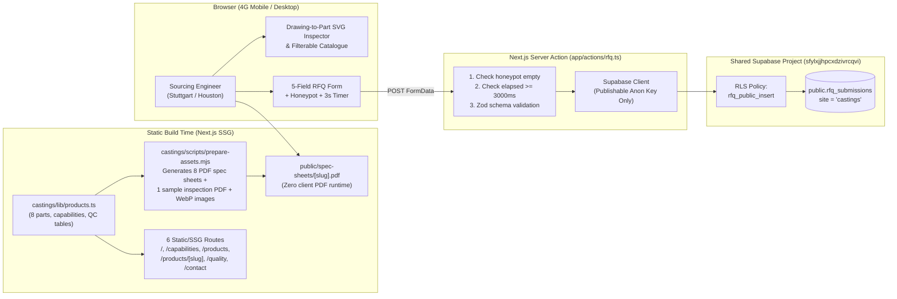

# Demo 2 Plan — Precision Castings & Machined Components (`castings/`)

**Status:** Awaiting User Approval  
**Fiverr Package Mapping:** Standard Package + per-product build-time PDF spec sheets  
**Target Buyers:** OEM procurement managers, sourcing engineers, and industrial distributors in **Germany** (Stuttgart, Munich, Hamburg) and the **USA** (Midwest / Great Lakes, Houston). They read drawings, tolerances, ASTM/EN/DIN material grades, and inspection equipment before they read marketing copy.  
**Tone:** Precise · engineered · no-nonsense.

---

## 1. Proposed Fictional Company Names (Choose 1)

Per [briefs/castings.md](file:///c:/Users/dudej/Projects/website-demos/briefs/castings.md), please approve **one** of these three invented names before build starts:

1. **Aakarshan Metallurgy & CNC** *(Rajkot, Gujarat — "Aakarshan" evokes precision forming; sounds authentic to a Rajkot GIDC Metoda engineering export unit)* — **(Recommended)**
2. **Saurashtra Alloy & Precision Cast** *(Region-anchored, industrial, immediately signals foundry + CNC capability in Gujarat's casting belt)*
3. **Kinesis Cast & Machine Works** *(Technical, export-oriented industrial marque)*

*Every page footer and OpenGraph image will carry the mandatory integrity notice:*  
`Concept design — fictional company. Website by Rajiv Dudeja.`

---

## 2. Visual Identity & Design System

| Token | Specification | Usage |
|---|---|---|
| **Display & Heading Font** | **Archivo** (`next/font/google`, variable `wdth` axis 112.5–125 for expanded technical headings, weights 600–700) | H1–H3, section headers, capability metrics |
| **Technical & Spec Font** | **IBM Plex Mono** (`next/font/google`, weights 400, 500, 600, `tabular-nums`) | Part numbers, ASTM/EN/DIN grades, tolerances (`±0.05 mm`), Ra values, HS codes, tables |
| **Body Font** | **Archivo** (weight 400, 500, normal width 100) | Body copy, process descriptions, form controls |
| **Primary Dark (`graphite`)** | `#14171A` | Primary background for Hero, Drawing-to-Part Inspector, Process Line, Footer |
| **Elevated Dark (`graphite-light`)** | `#1C2126` | Technical cards, CAD overlay callout boxes, spec panels |
| **Neutral Mid (`steel`)** | `#8A949C` | Secondary labels, CAD hairlines (`1px solid rgba(138,148,156,0.28)`), dimension ticks |
| **Light Surface (`paper`)** | `#ECEEF0` | High-contrast daylight engineering sheet sections (Catalogue, Spec tables, Quality reports) |
| **Single Accent (`molten`)** | `#FF5A1F` (Molten Orange) | Primary RFQ CTAs, active CAD callout highlights, dimension leader arrows, focus rings |

### Distinctiveness from Demo 1 (`spices/`)
- **Spices** used warm serif editorial (*Fraunces* + *Manrope*), espresso/cream/turmeric, and organic macro photography.
- **Castings** uses expanded grotesque + monospace (*Archivo Expanded* + *IBM Plex Mono*), cold industrial `graphite #14171A` / `paper #ECEEF0` / `molten #FF5A1F`, thin `1px` CAD title-block borders, corner registration crosshairs (`+`), and isometric/orthographic dimension callouts.

---

## 3. Sitemap & Every Section's Single Job (6 Pages)

All public routes are statically generated (`SSG`) at build time and carry `<meta name="robots" content="noindex, nofollow">`.

### Page 1: Home (`/`)
1. **Technical Top Bar & Sticky Header** — *One job:* Show ISO-style capability summary (`SS 304/316 · WCB · GGG40 · 5-Axis CNC · FOB Mundra / CIF Hamburg`) and keep `"Request a quote"` one click away.
2. **Hero Section (`#site-hero`)** — *One job:* State exact manufacturing scope in the H1 (*"Investment castings and 5-axis CNC-machined components from Rajkot, built to DIN/ASTM drawing tolerances"*), display key tolerance/weight badges (marked `sample figure`), and drive clicks to `"Request a quote"` above the fold on mobile & desktop.
3. **Signature Moment: "Drawing to Part" Interactive CAD Inspector (`#drawing-inspector`)** — *One job:* Prove engineering literacy by overlaying an interactive SVG technical drawing (dimension arrows, datum targets `A|B|C`, geometric tolerance frames, and 5 clickable/hoverable callout nodes) over a high-resolution machined **SS 316 CF8M Flanged Valve Body** macro photograph as the user scrolls.
   - *3D Decision:* Skip React Three Fiber (`Three.js`). A crisp 2D macro photograph + precision SVG orthographic dimension overlay beats a generic low-poly 3D mesh for engineering realism, keeps initial JS well under 200 KB gzip, and guarantees 4G mobile LCP ≤ 2.5 s.
4. **Capability Numbers Bar** — *One job:* Give procurement engineers scannable hard limits in `IBM Plex Mono` (`0.05 kg – 85 kg` casting weight, `±0.02 mm` CNC bore tolerance, `Ra 0.8 µm` machined finish, `1,800 MT/yr` installed output — every figure explicitly badged `sample figure`).
5. **Supporting Moment: Horizontal "Process Line" (`#process-line`)** — *One job:* Walk the buyer through the 6-stage controlled workflow (**01 Pattern & Wax → 02 Ceramic Shell → 03 Induction Pour → 04 5-Axis CNC Machine → 05 CMM & NDT Inspect → 06 VCI Seaworthy Pack**) with a scroll-linked horizontal sequence and progress bar (1 of max 2 pinned sections on desktop; clean vertical timeline on `< 768px` and `prefers-reduced-motion`).
6. **Industries Served Grid** — *One job:* Map components to buyer verticals (Flow Control & Valves, Pumps & Fluid Handling, Off-Highway & Ag Machinery, Marine & Deck Hardware, Industrial Automation) with typical ASTM/DIN grades and part examples.
7. **Inline RFQ Conversion Band** — *One job:* Capture quote requests directly on the homepage with the 5-field RFQ form, the exact placeholder `"e.g. SS316 valve body, 2,000 pcs/yr, drawing available"`, and the note `"Drawings: after we reply, we send a secure upload link."`

### Page 2: Capabilities (`/capabilities`)
1. **Capabilities Header** — *One job:* Frame the plant as an integrated foundry + machine shop (eliminating multi-vendor handoff risk for overseas OEMs).
2. **Five Capability Modules (each with a Mono Capability Table)** — *One job:* Provide exact process envelopes for:
   - **Investment Casting (Lost-Wax Silica Sol)**: Weight `0.05–45 kg`, linear tolerance `ISO 8062 CT5–CT6`, min wall `2.0 mm` (`sample figure`).
   - **Resin Sand & Shell Mould Casting**: Weight `2.0–85 kg`, tolerance `CT7–CT9`, ductile iron & carbon steel (`sample figure`).
   - **CNC Turning & 5-Axis Milling**: Positional tolerance `±0.015 mm`, bore roundness `0.008 mm`, max swing `650 mm` (`sample figure`).
   - **In-House Heat Treatment**: Solution annealing, normalizing, quench & temper with calibrated furnace chart logging (`sample figure`).
   - **Surface Finishing & Passivation**: Shot blasting, pickling & passivation (`ASTM A967`), zinc-nickel plating, epoxy primer (`sample figure`).
3. **Material Cross-Reference Matrix** — *One job:* Show side-by-side equivalents across **ASTM / EN / DIN / Werkstoff Nr.** (e.g., `ASTM A351 CF8M ↔ EN 10213 GX5CrNiMo19-11-2 ↔ DIN 1.4408`).

### Page 3: Products Catalogue (`/products`)
1. **Interactive Filter Bar** — *One job:* Let engineers filter the 8 components instantaneously by **Material** (`Stainless Steel`, `Carbon & Alloy Steel`, `Ductile Iron`, `Aluminium`), **Process** (`Investment Casting + CNC`, `Sand Casting + CNC`, `Bar-Stock CNC`), **Weight Range** (`< 2 kg`, `2–15 kg`, `> 15 kg`), and **Industry** (`Valves & Flow Control`, `Pumps`, `Automotive & Ag`, `Marine`).
2. **8-Part Technical Catalogue Grid** — *One job:* Present each part like an engineering index card with part number, 4-digit HS code, ASTM/DIN grade, tolerance badge (`sample figure`), direct PDF spec-sheet download link, and product detail link.

### Page 4: Product Detail (`/products/[slug]` — 8 Static Routes)
1. **Component CAD Header & Dual View Gallery** — *One job:* Show the primary studio shot + secondary detail view alongside an SVG dimensional summary callout box.
2. **Monospace Engineering Specification Table** — *One job:* Display all 11 brief-mandated rows in `IBM Plex Mono`:
   - Material Grade (ASTM / EN / DIN equivalents)
   - Net Finished Weight (`sample figure`)
   - Envelope Dimensions (`sample figure`)
   - General & Machined Tolerances (`sample figure`)
   - Surface Finish `Ra` (`sample figure`)
   - Minimum Order Quantity / Annual Batch (`sample figure`)
   - Standard Tooling & Production Lead Time (`sample figure`)
   - 4-Digit HS Code (`7325`, `7326`, `8481`, `8413`, `7307`, `8483`)
   - Incoterms (`FOB Mundra (INMUN)`, `CIF Hamburg (DEHAM)`, `CIF Houston / Newark`)
   - Export Packaging (`VCI polybag + ISPM-15 heat-treated fumigated wooden crate`)
3. **Build-Time Spec-Sheet PDF Download Button** — *One job:* Allow immediate download of `/spec-sheets/[slug].pdf` (generated at build time from `lib/products.ts` — zero client-side PDF JS).
4. **Pre-filled Component RFQ Form** — *One job:* Pre-populate the `product_quantity` field with the selected component's part name, material grade, and sample MOQ.

### Page 5: Quality & Inspection (`/quality`)
1. **Metrology & NDT Equipment Roster** — *One job:* Prove inspection rigour: Bridge CMM (3D coordinate verification), Optical Emission Spectrometer (28-element melt check per heat), Hydrostatic Pressure Test Rig, Ultrasonic / Magnetic Particle / Radiography NDT partners, and Surface Roughness Profilometer.
2. **PPAP Level 3 / First Article Inspection (FAI) Workflow** — *One job:* Explain how initial sample batches are qualified before serial export production (`EN 10204 3.1` mill test workflow).
3. **Sample Inspection Report Table (`Marked Sample`)** — *One job:* Display an actual dimensional + chemical + mechanical readout table for lot `SAMPLE-LOT-RK-2026-08` with nominal, tolerance (`±0.05 mm`), measured values, and CMM pass status (every number marked `sample figure`).
4. **3 Clearly Labelled "Sample Certificate" Placeholders** — *One job:* Show `SPEC-CERT-01` (Quality Management System — Sample Certificate Placeholder), `SPEC-CERT-02` (Pressure Equipment Material Scope — Sample Certificate Placeholder), and `SPEC-CERT-03` (EN 10204 3.1 Material Test Certificate — Sample Placeholder) with zero real certification logos.

### Page 6: Contact / RFQ (`/contact`)
1. **Direct Engineering RFQ Form** — *One job:* Convert the visitor in ≤ 5 fields (`name`, `email`, `country`, `product_quantity`, `message`), showing the required note: `"Drawings: after we reply, we send a secure upload link."` and 24-hour response promise.
2. **Export Logistics & Fictional Plant Coordinates** — *One job:* Provide transparent fictional plant details (`Plot 412, GIDC Metoda Industrial Estate, Kalavad Road, Rajkot 360021, Gujarat, India [fictional]`), Mundra Port (`INMUN`) container loading schedule (`sample figure`), and WhatsApp Export Desk link.

---

## 4. The 8 Products (`castings/lib/products.ts`)

| # | Slug | Product Name | HS Code (4-digit) | Material Equivalents (ASTM / EN / DIN) | Process | Net Weight (`sample figure`) | Key Machined Tolerance (`sample figure`) |
|---|---|---|---|---|---|---|---|
| 1 | `ss316-valve-body` | **SS316 Flanged Ball Valve Body (DN50)** | `8481` | ASTM A351 CF8M / EN 1.4408 / DIN GX5CrNiMo19-11-2 | Investment Casting + 5-Axis CNC | `6.80 kg` | `±0.03 mm` (seat bore) |
| 2 | `closed-pump-impeller` | **Closed-Vane Centrifugal Pump Impeller** | `8413` | ASTM A743 CA6NM / EN 1.4317 / SS 316L | Investment Casting + Dynamic Balance + CNC | `4.25 kg` | `±0.04 mm` (hub bore `H7`) |
| 3 | `weld-neck-flange` | **ASME B16.5 Class 300 Weld-Neck Flange** | `7307` | ASTM A182 F316L / EN 1.4404 / A105N | Forged / Cast Blank + CNC Turning & Drilling | `8.90 kg` | `±0.05 mm` (raised face `Ra 3.2`) |
| 4 | `ductile-iron-bracket` | **Heavy-Duty Chassis & Axle Mounting Bracket** | `7325` | ASTM A536 65-45-12 / EN-GJS-400-15 (GGG40) | Resin Sand Casting + 4-Axis CNC Milling | `18.40 kg` | `±0.05 mm` (dowel pin bores) |
| 5 | `aluminium-actuator-housing` | **Die/Sand-Cast Pneumatic Actuator Housing** | `8481` | ASTM B26 A356-T6 / EN AC-42100 (AlSi7Mg0.3) | Gravity Die / Shell Casting + High-Speed CNC | `2.65 kg` | `±0.025 mm` (piston cylinder bore) |
| 6 | `tractor-linkage-yoke` | **Three-Point Hitch Lift Arm & Linkage Yoke** | `7326` | AISI 4140 / 42CrMo4 (EN 1.7225) Quenched & Tempered | Investment Casting + CNC Broaching & Milling | `7.10 kg` | `±0.04 mm` (cross-pin bore) |
| 7 | `ss316-marine-deck-fitting` | **Mirror-Passivated Offshore Mooring Fairlead & Cleat** | `7325` | ASTM A351 CF3M (SS 316L) / EN 1.4409 | Silica-Sol Investment Casting + Electropolish + CNC | `3.40 kg` | `±0.08 mm` (mounting base) |
| 8 | `machined-shaft-coupling` | **Keyed Rigid & Flanged Drive Shaft Coupling** | `8483` | AISI 1045 / C45E (EN 1.1191) Black Oxide | Bar / Near-Net Blank + Precision CNC Turning & Keyway | `5.30 kg` | `±0.015 mm` (`H7` shaft bore) |

---

## 5. Motion Plan Table

> **Motion Rule Check:** Animate `transform` and `opacity` only, **plus one requested SVG exception below**: `stroke-dashoffset` on the SVG technical dimension lines and callout leader lines inside `#drawing-inspector` (explicitly required by [briefs/castings.md](file:///c:/Users/dudej/Projects/website-demos/briefs/castings.md#L26): *"A hero product image with SVG dimension lines and callouts that draw in on scroll (stroke animation)"*). All below-the-fold GSAP imports are gated behind `IntersectionObserver` so initial mobile hydration has zero main-thread blocking.

| Element | Trigger | Duration / Easing | Properties Animated | What It Communicates |
|---|---|---|---|---|
| **1. "Drawing to Part" SVG Dimension Lines & Leaders (`#drawing-inspector`)** *(Signature Moment)* | `ScrollTrigger` (`start: 'top 70%'`, `end: 'bottom 55%'`, `scrub: 0.4`), gated by `IntersectionObserver` | Scrub-linked (`0.8s` equivalent stagger across 5 callout leaders) | `stroke-dashoffset` (SVG leader lines & datum ticks) + `opacity` & `transform: translateY(10px -> 0)` on callout tags | Visually overlays a live CAD inspection drawing onto the physical SS316 casting, proving the foundry builds directly to engineering print tolerances. |
| **2. Interactive Callout Node Highlight (`#drawing-inspector`)** | Hover / focus / tap on any of the 5 callout badges (`Material`, `Seat Bore ±0.03mm`, `Surface Ra 0.8`, `Wall CT5`, `Weight 6.80kg`) | `0.2s ease-out` | `opacity` & `transform: scale(1 -> 1.08)` on target SVG zone ring | Lets a sourcing engineer inspect specific machined vs. as-cast surfaces on the valve body. |
| **3. Horizontal "Process Line" Sequence (`#process-line`)** *(Supporting Moment — 1 pinned section on desktop)* | `ScrollTrigger` (`pin: true` on `>= 1024px`, `scrub: 0.5`, travel `180%` viewport height) | Scrub-linked across 6 stage cards | `transform: translateX(...)` on stage track + `transform: scaleX(0 -> 1)` on molten-orange progress bar | Communicates end-to-end single-site control from wax pattern assembly to VCI export crating without subcontractor handoffs. |
| **4. Sticky Mobile Bottom CTA Bar** | `IntersectionObserver` on `#site-hero` (`!isIntersecting`) | `0.25s ease-out` | `transform: translateY(100% -> 0)` | Keeps the RFQ conversion path reachable with one thumb tap after scrolling past the hero. |

*`prefers-reduced-motion: reduce` fallback:* All SVG dimension lines render at `stroke-dashoffset: 0` immediately; the Process Line renders as a clean static 6-card grid without scroll pinning.

---

## 6. Data Flow Diagram (Mermaid)

---

## 7. Asset List & Sources (`castings/public/`)

All images will be converted to high-efficiency `.webp` via `sharp` in `castings/scripts/prepare-assets.mjs` and logged with full URLs and licences in `docs/credits.md`. No hero video is needed for `castings` — the hero and signature section rely on razor-sharp macro photography + interactive SVG CAD overlays, keeping mobile LCP ultra-fast (`< 1.8 s`).

| Asset Path | Description | Source Strategy | Target Size |
|---|---|---|---|
| `public/images/hero/valve-body-cad-base.webp` | Precision CNC-machined SS316 flanged valve body macro on dark graphite surface (base for SVG Drawing-to-Part inspector) | AI-generated (`image-generator`) or licensed Unsplash/Pexels industrial CNC macro | `≤ 85 KB` |
| `public/images/products/ss316-valve-body-1.webp` & `-2.webp` | SS316 Flanged Ball Valve Body (studio + bore closeup) | Licensed Unsplash/Pexels industrial photography + `sharp` technical grading | `≤ 65 KB` each |
| `public/images/products/closed-pump-impeller-1.webp` & `-2.webp` | Centrifugal pump impeller (vane profile + machined hub) | Licensed Unsplash/Pexels | `≤ 65 KB` each |
| `public/images/products/weld-neck-flange-1.webp` & `-2.webp` | ASME Class 300 Weld-Neck Flange (raised face + bolt circle) | Licensed Unsplash/Pexels | `≤ 65 KB` each |
| `public/images/products/ductile-iron-bracket-1.webp` & `-2.webp` | Heavy ductile iron chassis bracket (milled datum pads) | Licensed Unsplash/Pexels | `≤ 65 KB` each |
| `public/images/products/aluminium-actuator-housing-1.webp` & `-2.webp` | A356-T6 aluminium housing (finned body + CNC bore) | Licensed Unsplash/Pexels | `≤ 65 KB` each |
| `public/images/products/tractor-linkage-yoke-1.webp` & `-2.webp` | 42CrMo4 alloy steel linkage yoke | Licensed Unsplash/Pexels | `≤ 65 KB` each |
| `public/images/products/ss316-marine-deck-fitting-1.webp` & `-2.webp` | Mirror-passivated SS316L marine mooring cleat/fairlead | Licensed Unsplash/Pexels | `≤ 65 KB` each |
| `public/images/products/machined-shaft-coupling-1.webp` & `-2.webp` | C45E precision turned shaft coupling with keyway | Licensed Unsplash/Pexels | `≤ 65 KB` each |
| `public/images/process/step-01-pattern.webp` .. `step-06-pack.webp` | 6 process photos (Wax pattern, Ceramic shell, Induction pour, 5-axis CNC, CMM probe, Seaworthy crate) | Licensed Unsplash/Pexels foundry & CNC photography | `≤ 60 KB` each |
| `public/spec-sheets/[slug].pdf` (8 files) + `public/sample-cmm-inspection-report.pdf` | Build-time generated technical PDF spec sheets (ASTM/DIN grades, tolerances, Incoterms, marked `SAMPLE FIGURE — FICTIONAL COMPANY`) | Generated deterministically by `castings/scripts/prepare-assets.mjs` | `~4 KB` each |

---

## 8. Items Requiring Your Approval Before Build

1. **Company Name:** Approve **#1 `Aakarshan Metallurgy & CNC`** (or pick #2 `Saurashtra Alloy & Precision Cast` or #3 `Kinesis Cast & Machine Works`).
2. **SVG Motion Exception:** Confirm approval for `stroke-dashoffset` animation on the SVG technical dimension lines and leader arrows in `#drawing-inspector` (as described in `briefs/castings.md`).
3. **Plan Approval:** Confirm we are good to build `castings/` following this plan.
