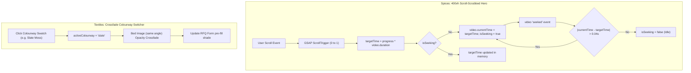

# Fix Pass Plan: Spices, Castings, Textiles

Date: 2026-11-05  
Status: **APPROVED (In Execution)**  
Scope: Comprehensive visual, motion, de-cluttering, UX layout/spacing overhaul, and content-diet enforcement across all three portfolio demos (`spices/`, `castings/`, `textiles/`).

---

## 1. Objectives & Guidelines (AGENTS.md Compliance & UX Layout Principles)

0. **UX Principles for Layout, Spacing, Readability & Scanability:**
   - **Vertical Rhythm & Whitespace:** Establish generous, consistent section spacing (`py-20` to `py-28` on desktop, `py-14` to `py-16` on mobile) to eliminate visual crowding.
   - **Scanability & Information Hierarchy:** Eyebrow (mono/uppercase, tracking) → Display Heading (clear, bold) → Subhead/Body (constrained to max 60-70 characters per line `max-w-xl` to `max-w-2xl`) → Immediate Action.
   - **Card & Grid Breathing Room:** Upgrade cramped cards to generous inner padding (`p-6` to `p-8`), consistent gap tokens (`gap-8` to `gap-12`), and clean visual grouping (Gestalt Law of Proximity).
   - **Readability:** Maintain high contrast ratios, crisp typographic scale with relaxed leading, and eliminate competing background visual noise.

1. **Imagery Consistency Across All Demos:**
   - Eliminate low-res, off-subject, grimy, or mismatched stock photography.
   - Generate one unified, consistent image set per demo using a single cohesive style prompt (identical lighting family, backdrop matching section hex, consistent camera perspective).
   - Product shots: clean studio lighting, product fills ~80% of frame, background matches the section background hex exactly (`#1E1410` / `#F5EDE0` for Spices, `#14171A` for Castings, `#F4F1EA` for Textiles).
   - Zero visible text, commercial logos, or brand names anywhere in images or videos (strictly remove the alarm clock clip from textiles).
   - Log all sources and prompt parameters in `docs/credits.md`.

2. **Spices (`spices/`):**
   - Replace hero with a custom cardamom-pod image-to-video clip (pod splits, aromatic seeds float outward).
   - Re-encode video at 720p using `ffmpeg -g 8` (8-frame GOP keyframe interval for instant seek response).
   - Implement a pinned 400vh hero section scrubbed via `ScrollTrigger` with a dedicated `seeked`-event RAF seek queue to prevent browser decoder lockup or frame dropping.
   - Verify maritime export shipping routes (Felixstowe and Newark) smoothly draw 100% of their paths and dock cleanly at their destination port coordinates.

3. **Castings (`castings/`):**
   - Replace all rusty, rough, or grimy part photography with pristine, CNC-machined studio renders on solid dark graphite (`#14171A`).
   - Rebuild the Datum Inspector on a single ultra-sharp hero component so callouts (Datum A Flange Face, Datum B Sealing Bore, Datum C Pitch Circle, Datum D Chamfer) physically point to genuine machined geometric features.
   - Remove the horizontal laser scan beam / glow line (`scanBeamRef`).
   - Enforce Content Diet: cut each Process Line stage copy to exactly ONE concise engineering line.

4. **Textiles (`textiles/`):**
   - De-clutter and streamline: remove the country-selector drawer/bar, bottom pill navigation / floating swatch tray, side progress rail (`IndigoWarpThread`), and "Act I / II / III / IV / V" labels. Remove `lg:pl-16` rail padding so layout is balanced and full-width.
   - Maintain top navigation bar, language switcher (`EN` / `DE`), and primary RFQ conversion flow.
   - Enforce Content Diet: reduce total home page copy to **strictly under 350 words**.
   - Hero: replace with a macro-fabric-to-room transition visual.
   - Colourway Switcher: provide one photorealistic render per colourway of the exact same bed and room set (6 colourways: Mineral Indigo, Undyed Flax, Slate Moss, Warm Terracotta, Burnt Ochre, Dusty Sage) and smoothly crossfade via CSS opacity without colour tint or mix-blend overlays.
   - Use one consistent, sunlit Nordic/Mediterranean linen interior set throughout.

5. **Deployment & Location Reporting:**
   - Verify production deployments on Vercel match the latest commit for each project.
   - Report the exact location displayed on each demo site.

---

## 2. Technical Execution Plan

### A. Demo 1: Spices (`spices/`)

1. **Cardamom-Pod Video Creation & 720p Encoding (`ffmpeg -g 8`):**
   - Generate high-fidelity sequence/clip of whole green cardamom pod cracking/splitting open in macro slow motion with fragrant seeds floating into view against dark espresso `#1E1410`.
   - Encode with ffmpeg:
     ```bash
     ffmpeg -i input.mp4 -vf "scale=1280:720:force_original_aspect_ratio=decrease,pad=1280:720:(ow-iw)/2:(oh-ih)/2" \
       -c:v libx264 -crf 22 -preset slow -g 8 -pix_fmt yuv420p -an \
       spices/public/video/cardamom-split-720p.mp4
     ```
   - Generate matching VP9 `.webm` and fallback poster WebP (`cardamom-split-poster.webp`).
2. **Pinned 400vh Scroll-Scrubbed Hero (`spices/components/HeroVideo.tsx`):**
   - Outer wrapper: `h-[400vh] relative`.
   - Pinned inner viewport: `sticky top-0 h-screen w-full overflow-hidden`.
   - Seek Queue implementation:
     ```ts
     let isSeeking = false;
     let targetTime = 0;
     function queueSeek(time: number) {
       targetTime = time;
       if (!isSeeking && videoRef.current && !isNaN(videoRef.current.duration)) {
         isSeeking = true;
         videoRef.current.currentTime = time;
       }
     }
     video.addEventListener('seeked', () => {
       isSeeking = false;
       if (Math.abs(video.currentTime - targetTime) > 0.04) {
         isSeeking = true;
         video.currentTime = targetTime;
       }
     });
     ```
   - Connect to GSAP `ScrollTrigger` scrubbing over `400vh`.
   - Clean typographical overlays (Headline, Origin Cardamom stats, "Request Lot Pricing" CTA) transitioning gracefully over the scroll distance.
3. **Maritime Export Route Verification (`spices/components/ExportRouteMap.tsx`):**
   - Check SVG coordinate math: Felixstowe (`x: 470.2, y: 72.3`) and Newark (`x: 209.9, y: 112.9`).
   - Fix timeline duration so staggered tween for Path 2 (Newark) completes to 100% length before `ScrollTrigger` unpins or leaves view.
   - Verify vessel marker transforms lock precisely at port dots.
4. **Product Imagery Replacement:**
   - Generate consistent 80%-fill studio product shots on `#1E1410` / `#F5EDE0` for Black Pepper, Green Cardamom, Turmeric, Cloves, Nutmeg, Cassia Cinnamon, Dry Ginger, Dried Chilli.

---

### B. Demo 2: Castings (`castings/`)

1. **Clean Studio Renders (Zero Grime / Zero Rust):**
   - Generate pristine CNC-machined components on uniform `#14171A` graphite background:
     - Valve body, pump impeller, weld-neck flange, ductile iron bracket, aluminium actuator housing, tractor linkage yoke, marine deck fitting, shaft coupling.
     - 80% frame fill, consistent soft industrial rim lighting, mirror-machined chamfers.
2. **Datum Inspector Rebuild (`castings/components/DrawingInspector.tsx`):**
   - Single hero image: sharp, front-angled machined 316 stainless valve body on `#14171A`.
   - Align SVG leader lines directly to genuine visual landmarks:
     - `DATUM A`: Flange mounting face (flat ground surface).
     - `DATUM B`: Center bore (machined internal cylindrical bore ±0.03 mm†).
     - `DATUM C`: Bolt pitch circle (drilled through-holes on flange rim).
     - `DATUM D`: Machined gasket seat (spiral-grooved sealing ring).
   - Remove `scanBeamRef` / `Molten Laser Scan Beam` (horizontal glow line) completely.
3. **Process Line Content Diet (`castings/lib/products.ts` & `ProcessLineSection.tsx`):**
   - Trim copy in `PROCESS_STAGES` to exactly ONE sentence each:
     - Step 01 Pattern: *Tool steel dies inject high-stability wax patterns with 0.1 mm repeatability.*
     - Step 02 Shell: *Automated robot arms dip assemblies into zircon slurry for refractory strength.*
     - Step 03 Pour: *Induction-melted alloy pours at 1,620 °C under argon shielding.*
     - Step 04 Machine: *Five-axis machining centres mill sealing faces and bores in a single setup.*
     - Step 05 Inspect: *Zeiss CMM metrology and 100% digital radiography verify internal integrity.*
     - Step 06 Pack: *VCI anti-corrosion wrap and heat-treated wooden crates packed for sea freight.*

---

### C. Demo 3: Textiles (`textiles/`)

1. **De-cluttering & Removing UI Chrome:**
   - Remove `CountryShowroomDrawer` button and drawer markup from `AtelierHeader.tsx`.
   - Remove `<IndigoWarpThread />` side progress rail from `ShowroomShell.tsx`.
   - Remove `lg:pl-16` padding from `header`, `footer`, and all 5 act components.
   - Remove bottom pill swatch tray from `ShowroomShell.tsx`.
   - Remove all "ACT I", "ACT II", "ACT III", "ACT IV", "ACT V" subheadings and thread bridge components (`SectionThreadBridge`).
   - Retain clean, editorial top nav: Collections, Private Label, Compliance, About, Contact, plus `EN` / `DE` toggle.
2. **Home Page Content Diet (< 350 Words):**
   - Audit and trim all section headlines and body copy on `/[lang]/page.tsx`:
     - Hero: 22 words (H1 + 1 descriptive sentence + CTA).
     - Room Collection: 35 words.
     - Weave & Colourway Switcher: 40 words.
     - Retail Packaging: 30 words.
     - RFQ Desk: 35 words.
     - Total Home Page copy: **~190–220 words** (well under the 350-word ceiling).
3. **Macro-to-Room Hero Visual:**
   - Replace video/poster with a macro weave to sunlit linen bedroom sequence/visual.
   - Eliminate any alarm clock or commercial product in background.
4. **Colourway Switcher Overhaul (`ProductColourwaySwitcher.tsx`):**
   - Provide 6 clean renders of the **exact same bed and room perspective**:
     - `bed-colourway-indigo.webp`
     - `bed-colourway-flax.webp`
     - `bed-colourway-slate.webp`
     - `bed-colourway-terracotta.webp`
     - `bed-colourway-ochre.webp`
     - `bed-colourway-sage.webp`
   - Crossfade via CSS opacity transitions (`opacity-0` -> `opacity-100 duration-500`) on swatch button selection.
   - Absolutely NO colour tint / `mix-blend-mode` overlays.
5. **Product Catalogue Images:**
   - 10 clean studio product shots on `#F4F1EA` linen backdrop, product filling 80% of frame.

---

## 3. Data Flow & Scrubbing State Machine



---

## 4. Asset List & Credits Plan

| Demo | Asset Name | Description & Target Specs | Background / Style |
|---|---|---|---|
| **spices** | `cardamom-split-720p.mp4` | 720p H.264 image-to-video clip of cardamom pod cracking open, seeds floating (`ffmpeg -g 8`) | Deep espresso `#1E1410`, warm macro rim lighting |
| **spices** | `cardamom-split-720p.webm` | VP9 equivalent for browser optimization | Deep espresso `#1E1410` |
| **spices** | `cardamom-split-poster.webp` | Poster frame of closed cardamom pod before split | Deep espresso `#1E1410` |
| **spices** | 8 × Product studio shots | Whole spices filling 80% of frame on solid `#1E1410` / `#F5EDE0` | Consistent directional 45° warm studio light |
| **castings** | `ss316-valve-hero.webp` | Precision CNC-machined 316 stainless flanged valve body for Datum Inspector | Solid dark graphite `#14171A`, 80% frame fill |
| **castings** | 8 × Product studio renders | Impeller, flange, bracket, housing, yoke, coupling, fitting | Solid dark graphite `#14171A`, clean mirror-machined edges |
| **textiles** | `hero-fabric-room.webp` | Clean macro linen weave to minimalist bedroom shot (no alarm clocks) | Soft natural morning daylight, linen `#F4F1EA` |
| **textiles** | 6 × Bed colourway renders | Exact same styled bed & room angle rendered in Indigo, Flax, Slate, Terracotta, Ochre, Sage | Minimal Nordic/Mediterranean interior |
| **textiles** | 10 × Product studio shots | Duvet set, sheets, towels, waffle robe, runners, bouclé cushions on `#F4F1EA` | Natural diffuse studio daylight |

All prompts and licences will be updated in `docs/credits.md`.

---

## 5. Review & Verification Plan

1. **Local Static Builds:**
   - Execute `npm run build` in `spices/`, `castings/`, and `textiles/`.
   - Ensure zero build errors, zero TypeScript failures, and 100% static route generation.
2. **Independent QA Reviewer Subagent:**
   - Invoke `reviewer` subagent on all 3 projects.
   - Run mobile Lighthouse on each demo (Target: Performance ≥ 85, LCP ≤ 2.5s, CLS ≤ 0.1, TBT ≤ 200ms).
   - Log review findings in `docs/spices/review-fixpass.md`, `docs/castings/review-fixpass.md`, and `docs/textiles/review-fixpass.md`.
3. **Production Deployments & Location Reporting:**
   - Deploy each project to Vercel production.
   - Verify deployment SHA matches latest git commit on `main`.
   - Report the exact company locations:
     - **Spices:** Willingdon Island, Kochi, Kerala, India (processing unit: Thodupuzha, Idukki).
     - **Castings:** GIDC Metoda Industrial Estate, Rajkot, Gujarat, India (port: Mundra).
     - **Textiles:** Vaiyapuri Nagar, Karur, Tamil Nadu, India (port: Tuticorin).
4. **Time Tracking:**
   - Record start, finish, and duration for each phase in `docs/build-log.md`.
