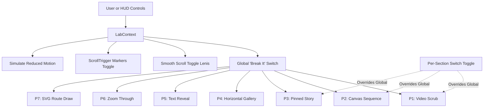

# Scroll Lab Architecture & Implementation Plan (`lab/`)

Status: **PROPOSED — AWAITING USER APPROVAL**  
Repo: `website-demos`  
Subdirectory: `lab/` (standalone Next.js App Router project deployed to Vercel, Root Directory = `lab`, `noindex`)

---

## 1. Overview & Objectives

**Scroll Lab** is an interactive engineering workbench designed to learn, test, and benchmark the 7 core scroll-storytelling patterns. Every pattern is built **twice**:
1. **The Correct Version**: Clean, robust, accessible, 60fps, GPU-composited (`transform` & `opacity` only), responsive, reduced-motion compliant, with zero layout thrash.
2. **The Common Broken Version**: Faithful reproduction of real-world bugs and anti-patterns (layout thrashing, missing seek queues, unkeyed video GOPs, rigid hard-coded offsets, character splitting fatigue, and continuous geometry recalculation).

A unified **Lab HUD** provides live telemetry (FPS, scroll position, section progress, active engine, and pattern-specific metrics like seek latency and dropped frames) alongside interactive diagnostic toggles.

---

## 2. Technical Stack & Dependencies

- **Framework**: Next.js 15+ (App Router), React 19, TypeScript
- **Styling**: Tailwind CSS (custom charcoal `#1A1714` background, turmeric `#D9911A` accent, cream text `#F5EDE0`)
- **Typography (`next/font/google`)**:
  - Display: `Fraunces` (variable optical size)
  - UI / Mono: `Manrope` + `JetBrains Mono`
- **Motion & Scroll**:
  - `gsap` + `gsap/ScrollTrigger` (client-only dynamic imports, single registry)
  - `@studio-freight/lenis` (optional smooth-scroll diagnostic toggle, strictly disabled on touch / reduced motion)
- **Deployment**: Standalone Vercel Project (Root Directory = `lab`), `<meta name="robots" content="noindex">`

---

## 3. Directory Layout & Architecture

```text
lab/
├── app/
│   ├── favicon.ico
│   ├── icon.svg
│   ├── layout.tsx              # Charcoal #1A1714 shell, fonts, metadata (noindex)
│   ├── page.tsx                # Single scroll lab page hosting all 7 pattern sections
│   ├── robots.ts               # Disallow all
│   └── sitemap.ts              # Minimal sitemap
├── components/
│   ├── hud/
│   │   ├── LabHud.tsx          # Fixed bottom-right telemetry & toggle bar
│   │   ├── FpsMeter.tsx        # High-precision RAF frame rate monitor
│   │   └── ReadoutBadge.tsx    # Compact badge for latency, dropped seeks, engine
│   ├── patterns/
│   │   ├── PatternWrapper.tsx  # Shared container: title, 25-word copy, toggle, collapsibles
│   │   ├── P1VideoScrub.tsx    # Pattern 1: Video scroll scrub (Seek Queue vs Unthrottled)
│   │   ├── P2CanvasSequence.tsx# Pattern 2: 96-frame Canvas WebP (Chunked Lazy vs Eager Blast)
│   │   ├── P3PinnedStory.tsx   # Pattern 3: 4-Step Pinned Story (Single Timeline vs Nested Triggers)
│   │   ├── P4HorizontalGallery.tsx # Pattern 4: Responsive Gallery (matchMedia/Function vs Hardcoded px)
│   │   ├── P5TextReveal.tsx    # Pattern 5: Editorial Reveal (Masked Line/Word vs Character Churn)
│   │   ├── P6ZoomThrough.tsx   # Pattern 6: Card Zoom (CSS View() Transform vs Reflow Width/Height)
│   │   └── P7SvgRouteDraw.tsx  # Pattern 7: SVG Maritime Draw (CSS/Dashoffset vs Path Length Thrash)
│   └── ui/
│       ├── Collapsible.tsx     # Animated accessible drawer for "How it works"
│       └── SwitchToggle.tsx    # Smooth segmented toggle (Correct / Broken)
├── context/
│   └── LabContext.tsx          # Global HUD state, markers, reduced motion, break-it overrides
├── lib/
│   ├── telemetry.ts            # Benchmarking hooks: seek duration, dropped seeks, reflow monitor
│   └── lab-data.ts             # Static text, routes, cardamom facts (max 25 words per section)
└── public/
    └── media/
        ├── pod-720-g8.mp4      # Correct 720p scrub file (GOP 8, ~24 keyframes)
        ├── pod-720-default.mp4 # Broken 720p file (default GOP, 1 keyframe)
        ├── pod-480-g8.mp4      # Mobile 480p scrub file
        ├── poster.webp         # First frame poster
        ├── frames/             # 96 WebP frames (f_001.webp - f_096.webp)
        └── steps/              # 4 step photos (vine, drying, sorting, packed)
```

---

## 4. State Management: The Lab HUD & Overrides

The lab state is coordinated via a lightweight `LabContext`:



### Telemetry Signals
1. **FPS Meter**: Rolling 60-frame timestamp delta using `performance.now()`.
2. **Current Section & Progress**: IntersectionObserver + ScrollTrigger updates tracking active section `[0..1]`.
3. **Active Engine**: Reports `CSS Scroll-Driven` vs `GSAP ScrollTrigger` vs `Native JS / Event Loop`.
4. **Pattern-Specific Readouts**:
   - P1: Video seek latency (ms) via `performance.now()` from seek dispatch to `seeked` event, dropped seek counter, active video size.
   - P2: Loaded memory (KB), total network requests, time to first decoded frame (ms).
   - P3: Active step index [1/4] and timeline scrub ratio.
   - P4: Panel index, translate `x` distance, window resize invalidation status.
   - P5: Split node count, rendered DOM nodes.
   - P6: Engine in use (`CSS animation-timeline: view()` vs `GSAP transform` vs `Layout Thrashing Reflows`).
   - P7: Draw progress %, path length calculations per second.

---

## 5. Detailed Component Specifications (The 7 Patterns)

### Pattern 1: Scroll-Scrubbed Video
- **Section Job**: Demonstrate seamless video scrubbing vs unthrottled keyframe stutter.
- **Copy**: One headline + 25 words on cardamom seed dispersion.
- **Frame Budget Note**: Calculated dynamically:
  $$\text{Budget} = \frac{\text{Track Height (e.g. 400vh)}}{\text{Frame Count (e.g. 192)}} = \text{px per frame (Target: 10–20 px)}$$
- **Correct Mode**:
  - `400vh` outer track, sticky `100svh` stage.
  - Video sources: `pod-720-g8.mp4` (desktop), `pod-480-g8.mp4` (mobile `< 768px`).
  - Seek queue: RAF gate flags pending target time; listens to `seeked` event before invoking next `.currentTime = targetTime`.
  - Fallback: Reduced motion shows crisp static `poster.webp`.
  - **Readout**: Median seek latency (aiming $< 35\text{ ms}$), 0 dropped seeks, active file size.
- **Broken Mode ("Broken: Direct currentTime on every scroll event + GOP 1")**:
  - Direct assignment `video.currentTime = time` on every window scroll event.
  - Uses `pod-720-default.mp4` (single initial keyframe).
  - Fast-scroll results in video freeze, massive decoding lockup, and skyrocketing seek latency.
  - **Readout**: Median seek latency ($> 250\text{ ms}$), hundreds of dropped seeks.

---

### Pattern 2: Canvas Image Sequence
- **Section Job**: Benchmark HTML5 Canvas image rendering against video scrub.
- **Correct Mode**:
  - 96 WebP frames rendered to `<canvas>` styled with `object-fit: contain`.
  - Preload chunking: Initial 10 frames preloaded for instant paint; remaining 86 frames lazy-loaded in background idle chunks.
  - Frame draw throttled strictly to `requestAnimationFrame` with `devicePixelRatio` scaling.
  - **Readout**: Total initial KB ($\sim 350\text{ KB}$), request waterfall count, time to first frame ($< 80\text{ ms}$).
- **Broken Mode ("Broken: Draw on unthrottled scroll + eager 96-image blast")**:
  - Instantiates and fetches all 96 images simultaneously on mount (`new Image()`).
  - Directly executes `ctx.drawImage()` in the raw scroll event listener without RAF synchronization.
  - **Readout**: Initial burst payload ($> 3.2\text{ MB}$), 96 concurrent requests saturating HTTP connections, canvas frame jitter.

---

### Pattern 3: Pinned Step Story
- **Section Job**: Multistage storytelling across 4 agricultural steps (Vine $\rightarrow$ Drying Yard $\rightarrow$ Sorting $\rightarrow$ Jute Bag).
- **Correct Mode**:
  - Sticky `100svh` stage pinned once over `300vh`.
  - Single GSAP Timeline containing synchronized crossfades and text transitions (`tl.to(stepA, ...).to(stepB, ...)`).
  - Clean `ScrollTrigger.refresh()` on mount.
  - **Readout**: Active step index (1 to 4), synchronized timeline progress.
- **Broken Mode ("Broken: Independent nested ScrollTriggers on each tween")**:
  - Creates separate `ScrollTrigger` instances inside nested child tweens.
  - Triggers trigger collisions, pin jump calculations, and scrub desynchronization when scrolling backwards.
  - **Readout**: Pin displacement jitter, out-of-sync step progress.

---

### Pattern 4: Horizontal Gallery
- **Section Job**: Full-bleed gallery cards showcasing cardamom pods across regions.
- **Correct Mode**:
  - Desktop: GSAP `pin: true` with dynamic function-based translate:
    `x: () => -(container.scrollWidth - window.innerWidth)` + `invalidateOnRefresh: true`.
  - Mobile: Uses `gsap.matchMedia` to disable pinning entirely and use native CSS horizontal swipe (`overflow-x: auto; scroll-snap-type: x mandatory`).
  - **Readout**: Current card index, exact pixel end-distance.
- **Broken Mode ("Broken: Hardcoded px end value + mobile pin lockup")**:
  - Fixed hardcoded translate: `x: -2400`. Resizing browser breaks horizontal alignment or truncates slides.
  - Pins on mobile viewports, locking touch scroll gestures.
  - **Readout**: Overflow clip error (px deficit/excess on resize).

---

### Pattern 5: Text Reveal
- **Section Job**: Contrast clean line/word mask reveals with character churn.
- **Correct Mode**:
  - (a) Headline: CSS mask or line wrap where lines rise from `translateY(100%)` with `overflow: hidden` on viewport entry.
  - (b) Editorial paragraph: Scrolled scrub where words smoothly transition opacity from `0.2` to `1.0`. Preserves accessible DOM text and screen reader flow (`aria-hidden` on split spans, raw text in visually-hidden parent).
  - **Readout**: Split count (clean 4 lines, 22 words).
- **Broken Mode ("Broken: Character splitting scrubbed over 2000px")**:
  - Splits text into individual `<span>` characters (180+ spans).
  - Scrubs character opacity and 3D rotation over a grueling 2,000px track.
  - Illegible mid-way, severely hurts DOM accessibility and frame pacing.
  - **Readout**: Node count (200+ spans), sluggish scroll feel.

---

### Pattern 6: Zoom-Through Reveal
- **Section Job**: Expand a centered cardamom pod card into full-bleed display.
- **Correct Mode**:
  - Uses modern CSS Scroll-Driven Animations:
    `animation-timeline: view(); animation-range: entry 0% cover 100%;` with `transform: scale()`.
  - Seamless fallback via `@supports not (animation-timeline: view())` executing lightweight GSAP `transform` scale.
  - GPU composited only; zero layout reflow.
  - **Readout**: Active Engine (`CSS view()` in Chromium / `GSAP fallback` in Firefox/Safari).
- **Broken Mode ("Broken: Animating width, height, top, and left")**:
  - Animates `width`, `height`, `left`, `margin` inside scroll updates.
  - Forces continuous browser layout reflow (layout thrashing) on every frame.
  - **Readout**: Layout reflow count per second ($> 50\text{ reflows/sec}$).

---

### Pattern 7: SVG Route Draw
- **Section Job**: Animate Cochin to Felixstowe maritime shipping route.
- **Correct Mode**:
  - Static SVG path geometry with build-time `getTotalLength()`.
  - Uses CSS scroll-driven `stroke-dashoffset` or single scrubbed GSAP timeline setting `strokeDashoffset`.
  - Path geometry is fixed; only vector dashoffset transforms.
  - **Readout**: Active Engine (`CSS` or `GSAP`), path draw percentage.
- **Broken Mode ("Broken: Recalculating path length & recreating attributes on every scroll")**:
  - Executes `path.getTotalLength()` and recalculates coordinates inside raw scroll listener on every pixel change.
  - Repeatedly updates DOM SVG attributes, causing CPU spikes.
  - **Readout**: Path calculations per second ($> 120\text{ calls/sec}$).

---

## 6. Bundle Budget & Performance Target

| Item | Budget | Target |
|---|---|---|
| **Lighthouse Mobile Score** | $\ge 85$ | $90+$ |
| **Initial JS Size (gzip)** | $\le 200\text{ KB}$ | $\approx 160\text{ KB}$ (Next.js core + GSAP tree-shaken + HUD) |
| **Hero Media Budget** | $\le 5\text{ MB}$ | $\approx 3.6\text{ MB}$ desktop / $1.8\text{ MB}$ mobile |
| **LCP (Mobile 4G)** | $\le 2.5\text{ s}$ | $\le 1.8\text{ s}$ |
| **CLS** | $\le 0.1$ | $0.00$ |
| **INP / TBT** | $\le 200\text{ ms}$ | $< 80\text{ ms}$ |

---

## 7. Execution Steps

1. **Step 1 — Approval**: User reviews and approves this architecture plan.
2. **Step 2 — App Initialization**: Setup `lab/` as a clean Next.js App Router workspace with Tailwind, GSAP, and typography configs.
3. **Step 3 — Media Linking**: Ingest user assets into `lab/public/media/` (`pod-720-g8.mp4`, `pod-720-default.mp4`, `pod-480-g8.mp4`, `poster.webp`, and `frames/`).
4. **Step 4 — Implementation of HUD & 7 Patterns**: Code each component with its Correct and Broken behaviors, toggle switches, and real-time readouts.
5. **Step 5 — Review & Verification**: Run independent reviewer subagent on `lab/` (performance, reduced motion, zero layout shift, security).
6. **Step 6 — Extraction**: Produce `docs/lab/snippets/` for the `scroll-storytelling` skill and populate `docs/lab/findings.md` with measured test telemetry.
