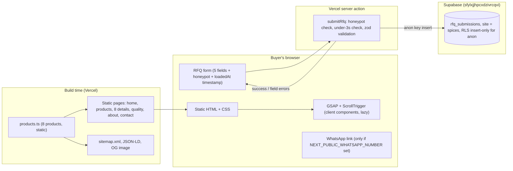

# Plan — Demo 1: Spice exporter (`spices/`)

Status: **DRAFT, awaiting approval.** No app code is written until this is approved and a name is chosen.

Brief: [briefs/spices.md](../../briefs/spices.md) · Rules: [AGENTS.md](../../AGENTS.md)

---

## 1. Company name — pick one

These are invented. Please check each against real companies (MCA/ROC search, Spices Board exporter list, Google, trademark search) before approving.

| # | Name | Why it fits |
|-|-|-|
| A | **Kurumulaku & Co.** | *Kurumulaku* is Malayalam for black pepper, the lead product. Short, warm, clearly Kerala. |
| B | **Elakkaya Spice Exports** | From *elakka* (cardamom). Sounds like a family firm from the Idukki hills. |
| C | **Ridgeline Kerala Spices** | English, easy for UAE/UK/US buyers to say. Points to the high-range farms. |

---

## 2. Sitemap

| Route | Page | Rendering |
|-|-|-|
| `/` | Home | Static (SSG) |
| `/products` | Products catalogue | Static; filtering on the client |
| `/products/[slug]` | Product detail × 8 | Static (`generateStaticParams`) |
| `/quality` | Quality & lab testing | Static |
| `/about` | About & sourcing | Static |
| `/contact` | Contact / RFQ | Static page; the form posts to a server action |
| `/sitemap.xml`, `/robots.txt` | SEO files | Generated at build time |
| `/opengraph-image` | OG image | Generated at build time (HTML text, no baked-in claims) |

Every page has `noindex`, the integrity footer and a unique title and meta description. Organization JSON-LD goes on every page; Product JSON-LD goes on product detail pages.

Product slugs (8): `black-pepper`, `green-cardamom`, `turmeric`, `cloves`, `nutmeg-mace`, `cassia-cinnamon`, `dry-ginger`, `dried-chilli`.

---

## 3. Sections and their single job

### Home `/`
| # | Section | One job |
|-|-|-|
| 1 | Header: wordmark, nav, "Request a quote" button | Gives a quote route from any scroll position. The CTA is visible above the fold at 390 px. |
| 2 | Hero: poster image, then video; H1 "Whole and ground spices from Kerala's high ranges, lab-tested lot by lot"; quote CTA + "View products" | Says what we sell, where it comes from and why it can be trusted, in 3 seconds. |
| 3 | Proof strip: markets served (UAE · UK · USA), lot traceability, lab-tested every lot, steam sterilisation (each figure labelled "sample figure") | Answers the procurement manager's first checklist without a click. |
| 4 | Featured products (4): pepper, cardamom, turmeric, chilli, shown as an asymmetric editorial row, not a 3-card grid | Shows range and grade detail, and leads into product pages. |
| 5 | **Export-route map (signature)** | Proves we already ship to the buyer's port, with transit times. |
| 6 | Farm → Port (pinned, 4 steps) | Shows a controlled, inspectable process, which is what makes the supplier trustworthy. |
| 7 | Quality teaser: 4 test parameters + link to /quality | Pre-empts the aflatoxin and pesticide-residue question. |
| 8 | RFQ band: short form (5 fields) | Converts. |
| 9 | Footer: integrity line, address "[fictional]", nav | Integrity and wayfinding. |

### Products `/products`
| Section | One job |
|-|-|
| Intro + category filter (All · Whole · Ground · Seeds · Blends), built as accessible buttons with `aria-pressed` | Gets the buyer to the right product fast. |
| Product grid (image, name, grade, HS code, MOQ) | Lets the buyer compare at a glance. |
| RFQ band | Converts buyers who don't open a detail page. |

### Product detail `/products/[slug]`
| Section | One job |
|-|-|
| Gallery (2–3 images) + name + grade chips | Shows the product is real and well handled. |
| Specs table: grade, moisture %, volatile oil %, origin, MOQ, packaging, HS code (4-digit), lead time, Incoterms (FOB Kochi, CIF), port of loading. All figures are labelled "sample figure". | Answers the technical buyer's questions in one place. |
| "Request a quote for this product" → `/contact?product=<slug>` (pre-fills the product field) | Converts with zero retyping. |
| Related products (3) | Keeps the buyer browsing. |

### Quality `/quality`
| Section | One job |
|-|-|
| Process (receive → clean → sterilise → test → pack) | Shows quality is designed in. |
| Test parameters table: moisture, aflatoxin B1/total, pesticide residue, Salmonella, with method and sample limit | Speaks the importer's compliance language. |
| Sample certificate placeholders (3 tiles marked "Sample certificate", no real logos) | Shows where real certificates would go, honestly. |
| Sample COA download (PDF watermarked "SAMPLE — fictional company") | Gives buyers a tangible artefact. |

### About `/about`
| Section | One job |
|-|-|
| Origin story (short, editorial) | Makes the company human. |
| Farm regions map (Idukki, Wayanad; simple SVG of Kerala) | Backs up the traceability claim. |
| Facility photos | Shows scale and cleanliness. |

### Contact `/contact`
| Section | One job |
|-|-|
| RFQ form + success state ("We reply within 24 hours with price, MOQ and lead time") | Converts. |
| Office address "[fictional]", WhatsApp button (hidden if the variable is empty), email | Offers a second channel. |

The sticky bottom CTA ("Request a quote") appears on mobile on every page once the hero has scrolled out of view.

---

## 4. Motion plan

One pinned section on Home (Farm → Port); the limit is 2. Every animation has a static `prefers-reduced-motion` fallback.

| Element | Trigger | Duration | What it communicates | Reduced-motion fallback |
|-|-|-|-|-|
| Hero poster → video | Video `canplay` after first paint (≥ 768 px; smaller encode on mobile, loaded after the `load` event) | 0.6 s opacity crossfade | Sensory richness, premium feel | Poster only, no video |
| Hero H1 + CTA | Rendered in HTML without JS. GSAP adds a subtle rise after hydration. | 0.5 s, transform/opacity | Calm confidence | Static |
| Featured product images | Scroll into view (ScrollTrigger, once) | 0.6 s rise + fade, 80 ms stagger | Each product is handled with care | Static |
| **Route lines Kochi → Jebel Ali / Felixstowe / Newark** | Scroll into view, scrubbed to scroll progress | ≈ 1.2 s each, staggered | "We already ship to your port." | Lines fully drawn |
| Route end labels (port + transit time, "sample figure") | Each line reaching its end | 0.3 s fade | Concrete transit times | Visible |
| Kochi port pulse | Once, when the map enters view | 1 s scale/opacity, runs 2× and stops | Origin point | Static dot |
| Farm → Port: 4 images crossfade + step counter 01–04 | Pinned, scrubbed (≈ 200 vh) | Follows scroll | A controlled process step by step | Stacked list of 4 steps, no pin |
| Sticky mobile CTA | Hero leaves the viewport (IntersectionObserver) | 0.25 s slide up (transform) | Quote route is always close | Appears without animation |
| Products filter | Button click | 0.2 s opacity | Responsive UI | Instant |

> [!NOTE]
> **One deliberate exception.** The brief asks for route lines drawn with `stroke-dashoffset`. That is an SVG paint property, not `transform`/`opacity`. It causes no layout shift, and it touches only 3 short paths inside one small SVG. I'm keeping it because the brief names it as the signature. Approving this plan approves the exception.

---

## 5. Data flow

- Products are static TypeScript, so public pages make no database reads.
- The server action uses only `NEXT_PUBLIC_SUPABASE_URL` and `NEXT_PUBLIC_SUPABASE_ANON_KEY`. RLS allows anon inserts only, and no reads.
- `/contact?product=<slug>` pre-fills the product field on the client (inside a `Suspense` boundary, so the page stays static).

---

## 6. Assets

All images are delivered through `next/image` (AVIF/WebP, explicit sizes). Each asset's exact URL and licence are logged in `docs/credits.md` when it is downloaded.

| Asset | Source | Target size |
|-|-|-|
| Hero video, desktop (slow-motion spices falling or being scooped, warm grade, 8–12 s loop) | Pexels or Coverr stock (search: "spices slow motion", "black pepper falling") | ≤ 3.5 MB MP4 (H.264) + WebM, 1280 px |
| Hero video, mobile | Same clip, re-encoded | ≤ 1.2 MB, 720 px |
| Hero poster (LCP) | Frame from the video, or a matching stock photo | ≤ 110 KB AVIF mobile, ≤ 200 KB desktop |
| 8 product photos (+1–2 alternates each, ≈ 20 images) | Pexels or Unsplash close-ups. AI-generated (image-generator subagent, photographic style) where stock is weak, e.g. Byadgi chilli or mace. | ≤ 80 KB each at display size |
| Farm → Port images × 4 (sourcing, sorting, lab, sacks at port) | Pexels or Unsplash; AI-generated if needed (no real company branding on sacks) | ≤ 120 KB each |
| Facility and regions photos × 3–4 (drying yard, hills, warehouse) | Pexels or Unsplash | ≤ 120 KB each |
| World map outline for the route map | Natural Earth 1:110m coastlines (public domain), simplified to an inline SVG | ≤ 12 KB inline |
| Kerala outline for the regions map | Natural Earth admin-1 (public domain), simplified | ≤ 6 KB inline |
| Sample COA PDF | Generated at build time by a script from the product data, watermarked "SAMPLE — fictional company" | ≤ 60 KB |
| Sample certificate placeholders | CSS/SVG tiles with the text "Sample certificate", no logos | 0 KB (code) |
| Icons | Hand-drawn inline SVG (line style), no emoji, no icon library | ≤ 4 KB total |
| Fonts | Fraunces (variable, `opsz` + `wght`) + Manrope via `next/font/google`, Latin subset only | ≈ 90 KB total, `display: swap` |

Total hero media: about 3.7 MB desktop and about 1.3 MB mobile, under the 5 MB cap.

---

## 7. Design notes

- **Palette:** espresso `#1E1410` (dark sections, body text on cream), cream `#F5EDE0` (main background), sand `#D8C7AE` (dividers, tags, muted backgrounds), and turmeric `#D9911A` for CTAs and highlights only.
- **Contrast:** turmeric on cream fails AA for text (about 2.4:1). So CTAs are turmeric buttons with espresso text (≈ 7:1), and turmeric is never used for text on cream.
- **Type:** Fraunces at high optical size for H1/H2 (soft, slightly wonky), Manrope 400/600 for body and UI. Specs tables use Manrope with tabular numbers.
- **Layout:** left-aligned hero over the video with a dark-to-transparent gradient (no centred hero card). Editorial asymmetric product row. Generous whitespace, thin sand rules.
- **Map style:** espresso land on a slightly darker espresso sea, turmeric route lines, cream labels.

---

## 8. Performance budget plan

| Budget | Plan |
|-|-|
| LCP ≤ 2.5 s | LCP element = hero poster (`next/image` with `priority`, AVIF, `fetchpriority=high`). Video is not the LCP and starts loading after `load`. |
| CLS ≤ 0.1 | Explicit width/height on every image and video. Fonts via `next/font` with size-adjust fallbacks. The sticky CTA is `position: fixed`, so it causes no reflow. |
| Initial JS ≤ 200 KB gzip | Next.js runtime + React ≈ 95 KB. GSAP core ≈ 27 KB + ScrollTrigger ≈ 17 KB, loaded only in client components that use motion, via dynamic import after first paint. Form ≈ 6 KB. **Estimate ≈ 150 KB.** zod runs only in the server action, not on the client. |
| INP ≤ 200 ms | No scroll-jacking. ScrollTrigger scrub with lightweight tweens. Filter is a simple state toggle. |
| Hero media ≤ 5 MB | ≈ 3.7 MB desktop, ≈ 1.3 MB mobile (see §6). |

---

## 9. Open items before build

1. **Pick a name** (A, B or C), or ask for 3 more.
2. **Vercel setup:** the existing Vercel project `website-demos` points at the repo root. For this demo I'll set it up per AGENTS.md: a project with Root Directory = `spices` (I'll rename/reconfigure the current one or create `spices`, whichever you prefer).
3. **WhatsApp number:** give one (international format, digits only) or leave it empty to hide the button.
