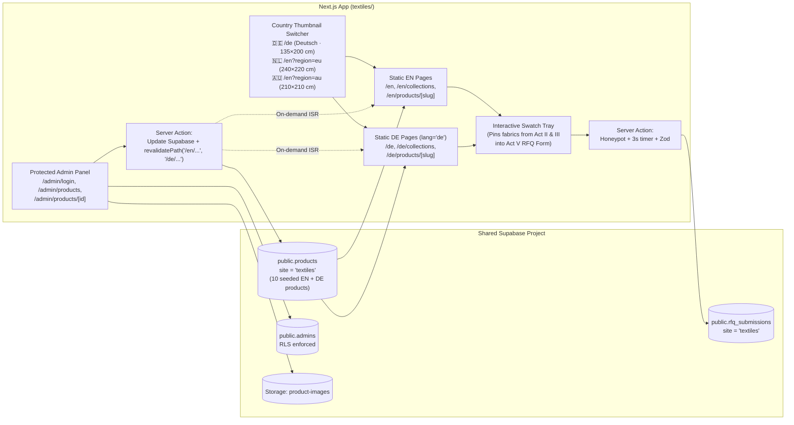

# Demo 3 Master Plan — NoolWeave Exports (`textiles/`)

**Status:** Awaiting User Approval Before Development  
**Approved Company Name:** **NoolWeave Exports** *(Karur, Tamil Nadu — "Nool" [நூல்] means yarn/thread in Tamil)*  
**Fiverr Package Mapping:** Premium Package (10 pages, bilingual `EN` + `DE` routes with visual country/market thumbnail selector, Supabase-backed product catalogue + live Admin Panel with on-demand ISR revalidation)  
**Tone:** Tactile · calm · considered.

---

## 1. Business Understanding, Scale, Target Markets & Buyer Personas

### 1.1 The Business & Company Scale
- **Who NoolWeave Exports Is:** A fictional vertically integrated home-textiles weaving mill and private-label export house based in **Karur, Tamil Nadu** (India's premier home-textile export cluster).
- **Scale & Capabilities to Project:**
  - Mid-to-large export mill operating **air-jet and rapier jacquard looms (`240 looms†`)**, in-house cheese/vat yarn dyeing with zero-liquid-discharge water recycling, automated cut-and-sew lines, and shelf-ready retail packaging (belly bands, woven brand labels, FSC hangtags, EAN barcoding).
  - Ships full container loads (`20' FCL / 40' HC`) and consolidated multi-colourway programs (`MOQ 300 sets per colourway†`) via **Tuticorin / Chennai ports**.

### 1.2 Target Markets & Buyer Personas
Unlike commodity spice traders (`spices`) or mechanical engineering buyers (`castings`), **home-textile retail buyers shop by room styling, tactile weave, seasonal colourways, and country-specific bed sizing**:

| Market | Buyer Persona | What They Need to See on the Site | Regional Spec & Language |
|---|---|---|---|
| **1. Germany / DACH (`🇩🇪 /de`)** *(Primary Focus)* | **Sabine — Head of Home Buying, Hamburg** (Department store & private-label retail chain) | Native German terminology (*Perkal, Leinen, Flächengewicht GSM, Mindestmenge*), colourway lab-dip flexibility, azo-free compliance placeholders, and **German duvet sizing (`135×200 cm` + `80×80 cm` pillow)**. | Native **German (`lang="de"`)** · `CIF Hamburg` |
| **2. Netherlands / EU (`🇳🇱 /en?region=eu`)** | **Pieter — Sourcing Director, Amsterdam / Rotterdam** (Concept home brand & hospitality importer) | Fast port consolidation (`CIF Rotterdam`), washed linen & waffle bath programs, low MOQ per colourway (`300 sets†`), and **EU double/king sizing (`200×200 cm` / `240×220 cm`)**. | **English (`lang="en"`)** · `CIF Rotterdam` |
| **3. Australia (`🇦🇺 /en?region=au`)** | **Liam — Private-Label Buyer, Melbourne** (Coastal home-living retail group) | Breathable flax linen & organic percale for Southern Hemisphere seasons, custom woven labels, and **Australian sizing (`Queen 210×210 cm` / `King 245×210 cm`)**. | **English (`lang="en"`)** · `CIF Melbourne` |

---

## 2. How This Template Eliminates the Structure of Demo 1 & Demo 2

Both `spices/` and `castings/` used a **6-section linear industrial funnel** (`Hero → Product Grid → Signature Map/CAD → Pinned Horizontal "Farm/Foundry-to-Port" Process → Quality Band → Quote Form`).

**`NoolWeave Exports` rejects that formula completely.** Instead of a linear factory funnel or another horizontal "Step 1 → Step 4" process clone, `textiles/` is built as an **Interactive Editorial Showroom & Live Swatch-Book Assembler**:

| Structural Element | Demo 1 (`spices`) & Demo 2 (`castings`) | Demo 3 (`textiles` — **NoolWeave Exports**) |
|---|---|---|
| **Overall Archetype** | Linear 6-section corporate/industrial landing page | **5-Act Interactive Showroom + Live Sample Swatch Tray** (buyers pin fabrics as they scroll into their custom Swatch Book) |
| **Color Polarity** | Dark mode (`#18110D` espresso / `#0D0F12` graphite) | **Sunlit Daylight Linen (`#F4F1EA`) & Alabaster (`#FAF8F4`)** + Deep Ink (`#1F2430`) + **Woven Indigo (`#2E3A8C`)** |
| **Navigation Architecture** | Top horizontal navbar | **Left Vertical Loom-Rail (`64px` spine)** + **Top Country Thumbnail Switcher Drawer** + **Floating Bottom Swatch Tray Pill** |
| **Product Discovery** | Hover list (`spices`) / 12-col Bento (`castings`) | **Interactive "Shop the Styled Room" Hotspot Panorama (Act II)** — click pulsing pins directly on the bed, pillows, throw & bath towel inside a sunlit room scene to inspect weave, switch colourways, and pin swatches! |
| **Signature Motion** | SVG shipping map / CAD drawing overlay | **Fanning Physical Swatch-Book Hanger + Draggable 4× Macro Weave Loupe (Act III)** — fabric cards fan out on scroll like a physical textile hanger while a circular loupe magnifies the yarn weave. |
| **How Manufacturing is Shown** | Pinned horizontal 4/6-step "Farm/Foundry-to-Port" scroll | **Interactive Retail-Readiness & Packaging Configurator (Act IV)** — buyers toggle between *Woven Brand Labels*, *Shelf-Ready Belly Bands & Barcodes*, and a *Live Karur Air-Jet Loom Video Window* (zero horizontal process clone). |

---

## 3. Hierarchy, Navigation & Multilingual Country Thumbnail System

### 3.1 Three-Part Atelier Navigation
1. **Left Vertical Loom-Rail (Desktop `lg:flex`, `64px` wide, fixed left):**
   - Houses the **NoolWeave woven-monogram SVG**, the live **Indigo Warp Thread progress indicator**, and rotated atelier coordinates (`KARUR MILL · 10.9601° N`).
2. **Top Country Showroom Switcher with Visual Thumbnails:**
   - Displays the active market pill and expands into (plus shows right in Act I) **3 Visual Country Cards with Thumbnails**:
     - **🇩🇪 Deutschland (`/de`, `lang="de"`):** Thumbnail of a sunlit Hamburg loft bedroom · switches entire site to **German** · sets regional spec context to `DE Standard (135×200 cm · 80×80 cm) · CIF Hamburg`.
     - **🇳🇱 Netherlands & EU (`/en?region=eu`):** Thumbnail of an Amsterdam canal-house bedroom · **English (EU)** · sets regional spec context to `EU Standard (240×220 cm · 60×70 cm) · CIF Rotterdam`.
     - **🇦🇺 Australia (`/en?region=au`):** Thumbnail of a Melbourne coastal linen bedroom · **English (AU)** · sets regional spec context to `AU Standard (210×210 cm Queen · 245×210 cm King) · CIF Melbourne`.
   - Switching `EN ↔ DE` on any page (`/en/collections` ↔ `/de/collections`, `/en/products/[slug]` ↔ `/de/products/[slug]`) preserves the exact route.
3. **Floating Bottom "My Swatch Book" Dock:**
   - Shows how many fabric swatches the buyer has pinned during their visit (e.g., `Swatch Tray (2) · Request Swatch Book & Quote`) and scrolls smoothly to the prefilled RFQ desk.

---

## 4. Scroll Continuity Element: The Continuous Indigo Warp Thread (`<IndigoWarpThread />`)

A **single continuous SVG Indigo Thread (`#2E3A8C`)** weaves through the entire page as the user scrolls (`strokeDashoffset` + a gliding loom-shuttle node), physically adapting to each Act:

1. **Act I (Country Gate & Unfolding Stage):** Unwinds from an SVG **Indigo Yarn Cone** at the top of the viewport into the expanding Macro-to-Room frame.
2. **Act II ("Shop the Room" Hotspot Panorama):** The thread traces across the room panorama to connect the **4 Interactive Linen Hotspot Pins** (`Duvet`, `Flax Sheet`, `Herringbone Throw`, `Bouclé Cushion`).
3. **Act III (Fanning Swatch Hanger & 4× Weave Loupe):** The thread becomes the **top binding ring** of the fanning fabric swatch cards and dynamically shifts its colour tint to match the active dye swatch (`Indigo`, `Undyed Flax`, `Terracotta`, `Sage`).
4. **Act IV (Retail Packaging & Live Loom Configurator):** The thread stitches the border of the **Woven Brand Neck Label preview**.
5. **Act V (Bound Swatch Book & RFQ Desk):** The thread terminates by stitching the spine of the buyer's **Custom Physical Swatch Book Card** next to the quote form.

---

## 5. Homepage Architecture — A 5-Act Interactive Showroom (No Duplicated Sections)

All acts strictly follow the **Content Diet**:
- **Max ~40 words of body text per section**, **one headline per section**, **max one number per section** marked with a dagger (`†`) and explained once in the footer (`EN` & `DE`).

### Act I — Country Showroom Index & Unfolding "Macro-to-Room" Stage (`#atelier-stage`, Pinned #1 on Desktop)
- **Layout:** Asymmetric 3-zone Atelier Opening:
  - **Top/Left Country Thumbnail Strip:** 3 tactile thumbnail cards (`🇩🇪 Deutschland /de`, `🇳🇱 Netherlands/EU /en`, `🇦🇺 Australia /en?region=au`) so the buyer immediately selects their market and language.
  - **Left Editorial Column:** Oversized `Newsreader` serif headline (*"Woven in Karur. Tailored for Hamburg, Rotterdam & Melbourne."*) + 1 sentence + `"Request Swatch Book & Quote"` CTA.
  - **Right Expanding Aperture (`7 cols`):** Starts as a tight **macro linen weave close-up** (`200 TC†`). As the user scrolls (`scrub: 0.5`), the macro weave crossfades and unfolds (`transform: scale(1 -> 1.15)`) to reveal a **sunlit bedroom video (`hero-bedroom-desktop.mp4`)** with soft natural daylight moving across washed linen bedding.

### Act II — Interactive "Shop the Styled Room" Hotspot Panorama (`#room-explorer`)
- **Why It's Unique:** Replaces a static card grid with an **interactive architectural room scene** (like Kvadrat / Tekla / IKEA Atelier lookbooks).
- **How It Works:**
  - Full-bleed daylight photography of a styled linen bedroom & adjoining spa bath featuring **4 pulsing Indigo Hotspot Pins** placed directly on the textiles:
    - `Pin 01` — **Washed Organic Percale Duvet Set** (`Bed · 200 TC†`)
    - `Pin 02` — **Garment-Washed European Flax Sheet Set** (`Bed · 170 GSM†`)
    - `Pin 03` — **Zero-Twist Combed Terry Bath Sheet** (`Bath · 600 GSM†`)
    - `Pin 04` — **Brushed Herringbone Sofa Throw** (`Living · 340 GSM†`)
  - Clicking or hovering any pin updates the **Slide-Over Tactile Inspection Card** beside the room: shows a close-up of that item, displays its **size for the buyer's selected country** (`DE 135×200 cm` / `EU 240×220 cm` / `AU 210×210 cm`), lets them click **`+ Add to Swatch Book`**, or jump straight to its full product page.

### Act III — Signature Moment: Fanning Swatch Hanger & 4× Macro Weave Loupe (`#weave-workbench`, Pinned #2 on Desktop)
- **Why It's Unique:** Simulates handling a real physical fabric hanger and textile magnifier glass (`Loupe`) on a mill table.
- **How It Works:**
  - **Left — Scroll-Fanned Fabric Swatch Stack:** As the section locks into view, 4 tactile fabric swatch cards (**Crisp Percale**, **European Flax Linen**, **Honeycomb Waffle**, **Slub Bouclé**) fan out radially (`transform: rotate()` & `translate3d()`).
  - **Right — 6 Seasonal Dye Swatches + Circular 4× Weave Magnifier:** Clicking any of the 6 vat-dyed shades (`Mineral Indigo`, `Raw Oat`, `Terracotta Clay`, `Salbei / Sage`, `Ochre Sand`, `Charcoal Slate`) smoothly crossfades the draped fabric photograph AND updates the **interactive 4× Macro Weave Loupe** (which follows cursor/touch position using `transform: translate3d`) so buyers can inspect the yarn twist and slub texture (`300 sets†` MOQ per colourway).

### Act IV — Retail-Readiness & Karur Loom Atelier (`#retail-readiness`)
- **Why It's Unique:** Completely replaces the "Step 1 → Step 4" horizontal process scroll from Demos 1 & 2 with an **Interactive Private-Label & Mill Switcher** focused on what retail buyers actually specify:
  - **Interactive 3-Mode Atelier Viewer:**
    1. **`01 Custom Woven Labels & Bilingual Care Tags`:** Macro visual of a private-label jacquard neck label and `DE / EN / NL` wash-care ribbon stitched onto washed linen.
    2. **`02 Shelf-Ready Packaging & Regional Barcoding`:** Visual of plastic-free kraft belly bands, FSC boxes, EAN barcodes, and pre-printed country size stickers (`135×200 cm DE` / `210×210 cm AU`).
    3. **`03 Live Karur Air-Jet Loom Hall & Compliance`:** Plays a **live video loop of air-jet looms weaving in Karur (`loom-weaving.mp4`, `240 looms†`)** alongside 2 clearly marked **"Sample Certificate — Placeholder Only"** compliance frames.

### Act V — Live Swatch Book Assembler & 5-Field RFQ Desk (`#quote`)
- **Layout:** Split 2-column tactile conversion desk where the continuous Indigo Warp Thread finishes by stitching into the Swatch Book spine:
  - **Left — Your Custom Swatch Book Card:** Displays the fabric/colourway chips the buyer selected in Acts II & III (with default starter swatches if none were clicked yet, plus one-click toggle chips for `Percale`, `Flax Linen`, `Waffle Bath`, `Herringbone Throw`).
  - **Right — 5-Field Localized RFQ & Swatch Request Form:**
    1. Name (`Ihr Name` / `Your name`)
    2. Business Email (`Geschäftliche E-Mail` / `Business email`)
    3. Country (`Land` / `Country` — auto-synced with the selected Country Thumbnail Desk!)
    4. Product, Colourways & Quantity (`Produkt & Menge` — auto-populated when swatches are pinned, placeholder: `"e.g. Percale duvet set, 3 colourways, 1,500 sets"`)
    5. Message (`Nachricht (optional)`)
  - Honeypot + `< 3 s` timer + Zod validation → inserts into Supabase `rfq_submissions` (`site = 'textiles'`).

---

## 6. All 10 Pages (Bilingual `EN` + `DE` Public Pages + Live Supabase Admin Panel)

### Public Routes (`/[lang]/...` where `lang` ∈ `['en', 'de']`, `<html lang={lang}>`):
1. **`/[lang]` (Home):** The 5-Act Interactive Showroom described above.
2. **`/[lang]/collections` (Editorial Lookbook & Filterable Catalogue):** Staggered magazine lookbook of all 10 Supabase products across `Bed`, `Bath`, `Kitchen`, and `Living`, with inline colourway swatch dots and a live **Regional Size Switcher (`🇩🇪 DE Sizes` · `🇳🇱 EU Sizes` · `🇦🇺 AU Sizes`)**.
3. **`/[lang]/products/[slug]` (10 Product Pages from Supabase):**
   - Interactive **Colourway Switcher** + **4× Macro Weave Loupe**.
   - Localized `EN` / `DE` headline and single concise paragraph (≤35 words).
   - **Strict 4-Row Table:**
     1. `Fibre & weave` / `Faser & Bindung`
     2. `Density / weight` / `Flächengewicht` (with `†`)
     3. `MOQ per colourway` / `Mindestmenge pro Farbe` (with `†`)
     4. `Lead time & Incoterms` / `Lieferzeit & Incoterms` (`CIF Hamburg / Rotterdam / Melbourne`, with `†`)
   - Regional Size Breakdown pill (`DE 135×200` · `EU 240×220` · `AU 210×210`) + `"Request quote"` & `"Order swatch cutting"` buttons.
4. **`/[lang]/private-label` (Private Label & Custom Packaging):** Interactive showcase of Pantone lab-dip matching (`7 days†`), custom jacquard labels, and retail packaging formats.
5. **`/[lang]/sustainability` (Sustainability & Compliance):** Zero-liquid-discharge water recycling in Karur + 2 clearly labelled **"Sample Certificate — Placeholder Only"** frames (no real GOTS/OEKO-TEX logos).
6. **`/[lang]/about` (About & Karur Mill):** The Karur weaving heritage, air-jet loom hall video/photography (`240 looms†`), and container consolidation to Hamburg, Rotterdam, and Melbourne.
7. **`/[lang]/contact` (Contact & Swatch Request Desk):** Fictional Karur mill address, WhatsApp export desk, Country Desk selector, and localized 5-field RFQ / Swatch Book form.

### Protected Admin Panel Routes (Excluded from Sitemap, Protected by Middleware + Supabase RLS):
8. **`/admin/login`:** Editorial sign-in (`Supabase Auth` email + password).
9. **`/admin/products`:** Searchable list of all 10 `textiles` products in Supabase, live `published` status toggle, and edit links.
10. **`/admin/products/[id]`:** Full bilingual editor (`name_en`, `name_de`, `description_en`, `description_de`, 4-row `specs` JSONB, `moq`, `hs_code`, `lead_time`, `incoterms`, `colourways`, plus image upload to Supabase `product-images` bucket). Saving triggers a Server Action that calls `revalidatePath('/en/...')` and `revalidatePath('/de/...')` so static public pages update immediately.

---

## 7. Motion & Continuity Plan Table

| # | Element | Act / Section | Trigger | Properties Animated | What It Communicates |
|---|---|---|---|---|---|
| 1 | **Continuous Indigo Warp Thread (`<IndigoWarpThread />`)** | Full Page (`Act I`→`Act V`) | `ScrollTrigger` (`scrub: 0.4`) | SVG `strokeDashoffset` + shuttle node `transform: translate3d` | Physically weaves through the Country Gate, Room Hotspots, Swatch Hanger, Label Configurator, and Swatch Book. |
| 2 | **Unfolding Macro-to-Room Stage** *(Pinned #1)* | Act I (`#atelier-stage`) | `ScrollTrigger` (`pin: true`, `scrub: 0.5`) | `transform: scale(1 -> 1.15)` on bedroom video + `opacity: 1 -> 0` on macro weave | Connects single-thread weaving craft to a sunlit styled bedroom. |
| 3 | **Country Thumbnail Showroom Switcher** | Act I & Top Drawer | Click / hover on `🇩🇪 DE`, `🇳🇱 NL/EU`, `🇦🇺 AU` thumbnail card | `transform: scale(1.04)` + instant route/language & bed-size context update | Proves country-specific sizing and native German/English buyer readiness. |
| 4 | **"Shop the Room" Hotspot Drawer & Pin Pulse** | Act II (`#room-explorer`) | Click / hover / focus on room pins `01`–`04` | `transform: translateX()` & `opacity` on inspection drawer + `scale` on pin ring | Lets buyers explore bedding, bath, and throws in context and pin swatches to their tray. |
| 5 | **Fanning Swatch Hanger & 4× Macro Loupe** *(Pinned #2 — Signature)* | Act III (`#weave-workbench`) | `ScrollTrigger` (`pin: true`, `scrub: 0.5`) + swatch click/cursor move | Swatch cards fan out via `transform: rotate() translate3d()`; colourway crossfades via `opacity`; loupe moves via `translate3d()` | Recreates the tactile experience of fanning a physical fabric hanger and inspecting yarn twist under a loupe. |
| 6 | **Retail-Readiness 3-Mode Switcher + Loom Video** | Act IV (`#retail-readiness`) | Tab select (`Labels` · `Packaging` · `Karur Looms`) | `opacity` & `transform: translateY(12px -> 0)` | Shows retail buyers exactly how their private-label goods are labelled, barcoded, and woven. |

*(Maximum 2 pinned sections on the homepage: Act I `#atelier-stage` and Act III `#weave-workbench`. Full `prefers-reduced-motion: reduce` static fallbacks for every animation.)*

---

## 8. Data Flow Diagram (Mermaid)

