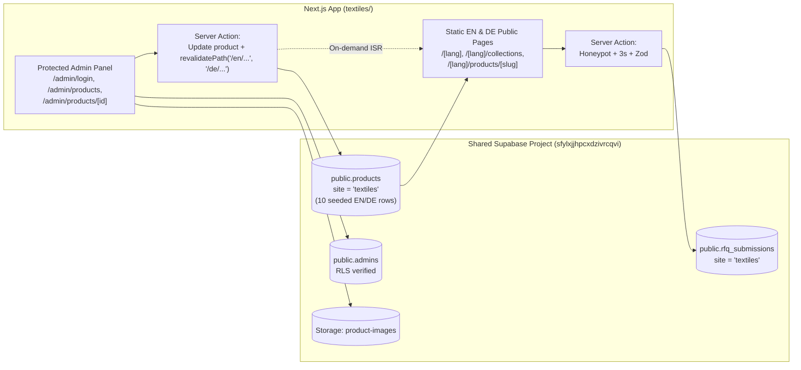

# Demo 3 Plan — Home Textiles Mill (`textiles/`)

**Status:** Awaiting User Approval  
**Fiverr Package Mapping:** Premium Package (10 pages, 2 languages `EN` + `DE`, Supabase Admin Panel with live revalidation)  
**Target Buyers:** Home-goods retail buyers, private-label brands, and importers in **Germany** (Hamburg, Berlin, Munich), the **Netherlands** (Amsterdam, Rotterdam), and **Australia** (Melbourne, Sydney).  
**Tone:** Tactile · calm · considered.

---

## 1. Proposed Fictional Company Names (Choose 1)

Per [briefs/textiles.md](file:///c:/Users/dudej/Projects/website-demos/briefs/textiles.md), please approve **one** of these three invented names before build starts:

1. **Valli & Loom Home Textiles** *(Karur, Tamil Nadu — warm, tactile, editorial; sounds authentic to a heritage Karur weaving house exporting to Europe)* — **(Recommended)**
2. **Noolaga Weave & Mill** *("Nool" means yarn/thread in Tamil; calm, architectural marque)*
3. **Amaravathi Linen & Looms** *(Named after the Amaravathi river flowing through Karur's textile belt)*

*Every page footer (in both English and German) and OpenGraph image will carry the mandatory integrity notice:*  
`Concept design — fictional company. Website by Rajiv Dudeja.`

---

## 2. Content Diet & Integrity Rules (Strictly Enforced)

- **Max ~40 words of body text per section**, **one headline per section**, **max one number per section** marked with a dagger (`†`) and explained once in the footer:
  - EN: `† All figures, capacities, thread counts and lead times shown are sample figures.`
  - DE: `† Alle angegebenen Zahlen, Kapazitäten, Fadendichten und Lieferzeiten sind Beispielwerte.`
- **No standards, test methods or long spec tables** in body copy (no real GOTS / OEKO-TEX / ISO logos or standard numbers).
- **Product detail pages get a 4-row table:**
  1. `Fibre & weave` / `Faser & Bindung`
  2. `Weight / density` / `Flächengewicht` (with `†`)
  3. `Minimum order` / `Mindestmenge` (with `†`)
  4. `Lead time` / `Lieferzeit` (`FOB Tuticorin / CIF Rotterdam`, with `†`)
- **`<meta name="robots" content="noindex">` on every page**, and `lang="de"` on German routes.

---

## 3. Visual Identity & Design System (`21st.dev` Editorial Craft)

| Token | Specification | Usage |
|---|---|---|
| **Display & Editorial Font** | **Newsreader** (`next/font/google`, variable optical size, weights 400–600, italic accents) | H1–H2, collection titles, editorial pull-lines |
| **UI & Body Font** | **Hanken Grotesk** (`next/font/google`, weights 400, 500, 600) | Body copy, navigation, language switcher, swatch chips, admin panel |
| **Primary Light (`linen`)** | `#F4F1EA` | Primary daylight surface with generous editorial whitespace |
| **Elevated Light (`linen-warm`)** | `#EAE5DA` | Secondary sections, swatch cards, 4-row spec tables |
| **Primary Dark (`ink`)** | `#1F2430` | Typography, dark editorial contrast sections, footer |
| **Neutral Mid (`stone`)** | `#B9B2A5` | Hairline borders (`1px solid`), subtle captions |
| **Single Accent (`indigo`)** | `#2E3A8C` (Deep Woven Indigo) | Primary RFQ CTAs, active colourway swatch rings, focus outlines |

---

## 4. Sitemap & Every Section's Single Job (10 Pages, `EN` + `DE` Public Routes)

Public pages are statically generated / cached (`/[lang]/...` where `lang` is `en` or `de`, with `/` redirecting or rendering `en` and setting `<html lang="de">` via a route-aware attribute/wrapper on German pages) and revalidated on demand (`revalidatePath`) whenever an admin saves a product in the Admin Panel.

### Public Pages (1–7, in both `EN` and `DE`):
1. **Home (`/[lang]`) — 6 Focused Sections:**
   - **Hero (`#site-hero`):** Macro fabric weave close-up that smoothly scales to reveal a sunlit styled bedroom on scroll (`transform` only). One headline, ≤25 words, `"Request a quote"` (`"Angebot anfordern"`) CTA.
   - **Collections Showcase:** 4 tactile collection panels (`Bed` · `Bath` · `Kitchen` · `Living`) with editorial hover scale (`transform` only).
   - **Signature Moment — Colourway Switcher Showcase (`#colourway-studio`):** Interactive tactile swatch bar (`Natural Oat`, `Mineral Indigo`, `Terracotta Clay`, `Sage Linen`) that crossfades the full-bleed product photography and macro weave inset (`opacity` & `transform` only).
   - **Private Label From Swatch to Port:** 4-step editorial sequence (`01 Swatch Dip` → `02 Loom Run` → `03 Retail Pack` → `04 CIF Rotterdam`).
   - **Compliance & Mill Snapshot:** Large loom photography + 1 sentence + 3 tactile pills (`Combed & Linen Yarns`, `Azo-Free Vat Dyed`, `Lot-Traced`).
   - **RFQ & Swatch Book Form (`#quote`):** 4 visible fields + optional message + `"Request a sample swatch book"` prefill toggle.
2. **Collections (`/[lang]/collections`):** Filterable showcase of all 10 products across `Bed`, `Bath`, `Kitchen`, and `Living` with inline colourway swatch switching on each card.
3. **Product Detail (`/[lang]/products/[slug]` — 10 Products from Supabase):**
   - Interactive **Colourway Switcher** (swatches crossfade product photo + macro texture).
   - One headline + one concise paragraph (≤35 words, localized `EN`/`DE` from Supabase `products`).
   - **Strict 4-Row Table** (`Fibre & weave`, `Density†`, `MOQ per colourway†`, `Lead time†`).
   - `"Request a quote"` + `"Request sample swatch"` buttons.
4. **Private Label & Custom (`/[lang]/private-label`):** Concise visual breakdown of custom pantone lab-dips, woven brand labels, and shelf-ready retail packaging (≤40 words per block).
5. **Sustainability & Compliance (`/[lang]/sustainability`):** Rainwater-recycled dye house overview + 2 clearly labelled `"Sample Certificate — Placeholder Only"` cards (zero real GOTS/OEKO-TEX logos).
6. **About & Mill (`/[lang]/about`):** Karur weaving mill story, air-jet loom hall photography, and export corridor to Rotterdam, Hamburg, and Melbourne.
7. **Contact / RFQ (`/[lang]/contact`):** Fictional mill address (`S.F. No. 218, Vaiyapuri Nagar, Karur 639002, Tamil Nadu, India [fictional]`), WhatsApp desk, and localized RFQ / Swatch Book form.

### Admin Panel Pages (8–10, Excluded from Sitemap & Protected by Middleware + Supabase RLS):
8. **Admin Login (`/admin/login`):** Clean `Newsreader` + `Hanken Grotesk` sign-in form using Supabase Auth (`signInWithPassword`).
9. **Admin Products List (`/admin/products`):** Searchable list of the 10 products in Supabase (`site = 'textiles'`), published status toggle, and direct edit links.
10. **Admin Product Edit (`/admin/products/[id]`):** Edit `name_en`, `name_de`, `description_en`, `description_de`, 4-row `specs` JSONB, `moq`, `hs_code`, `lead_time`, `incoterms`, `colourways`, and upload new images to the Supabase `product-images` storage bucket. Saving triggers a Server Action that calls `revalidatePath` on both `/en` and `/de` routes so public pages update immediately while staying static.

---

## 5. The 10 Seeded Products (Supabase `public.products` where `site = 'textiles'`)

| # | Slug | Category | EN Name | DE Name | 4-Row Table Summary |
|---|---|---|---|---|---|
| 1 | `washed-percale-duvet-set` | Bed | **Washed Organic Percale Duvet Set** | **Gewaschenes Perkal-Bettwäsche-Set** | `Long-Staple Cotton Percale` · `200 TC†` · `300 sets†` · `35 days† CIF Rotterdam` |
| 2 | `flax-linen-sheet-set` | Bed | **Garment-Washed European Flax Sheet Set** | **Reinleinen-Bettlakenset vorgewaschen** | `100% Pure Linen` · `170 GSM†` · `200 sets†` · `40 days† CIF Rotterdam` |
| 3 | `sateen-hotel-duvet-cover` | Bed | **Mercerised Sateen Stripe Duvet Cover** | **Satin-Streifen-Bettbezug merzerisiert** | `Combed Cotton Sateen` · `300 TC†` · `400 pcs†` · `30 days† FOB Tuticorin` |
| 4 | `aegean-combed-bath-towel` | Bath | **Zero-Twist CombedTerry Bath Sheet** | **Zero-Twist-Frottier-Badetuch** | `Low-Twist Combed Cotton` · `600 GSM†` · `500 pcs†` · `30 days† CIF Rotterdam` |
| 5 | `waffle-weave-spa-robe` | Bath | **Honeycomb Waffle Weave Bath Towel** | **Waffelpiqué-Saunatuch** | `Cotton-Linen Waffle` · `420 GSM†` · `400 pcs†` · `32 days† CIF Rotterdam` |
| 6 | `yarn-dyed-kitchen-towel` | Kitchen | **Yarn-Dyed Herringbone Tea Towel Set** | **Garngefärbtes Fischgrät-Geschirrtuch** | `Recycled Cotton Blend` · `240 GSM†` · `1,000 sets†` · `28 days† FOB Tuticorin` |
| 7 | `washed-linen-table-runner` | Kitchen | **Mitered-Hem Washed Linen Table Runner** | **Tischläufer aus gewaschenem Leinen** | `Linen-Cotton Plain Weave` · `210 GSM†` · `500 pcs†` · `30 days† CIF Rotterdam` |
| 8 | `boucle-textured-cushion-cover` | Living | **Slub-Woven Bouclé Cushion Cover** | **Kissenbezug aus Bouclé-Strukturgewebe** | `Textured Cotton Slub` · `380 GSM†` · `400 pcs†` · `28 days† FOB Tuticorin` |
| 9 | `herringbone-fringed-throw` | Living | **Brushed Herringbone Sofa Throw** | **Gebürstetes Fischgrät-Sofaplaid** | `Recycled Cotton Jacquard` · `340 GSM†` · `300 pcs†` · `32 days† CIF Rotterdam` |
| 10 | `quilted-matelasse-bedspread` | Bed | **Loom-Quilted Matelassé Coverlet** | **Gewebter Matelassé-Tagesdeckenüberwurf** | `Jacquard Double-Cloth` · `450 GSM†` · `200 pcs†` · `38 days† CIF Rotterdam` |

---

## 6. Motion Plan Table

| Element | Trigger | Duration / Easing | Properties Animated | What It Communicates |
|---|---|---|---|---|
| **1. Macro-to-Room Hero Reveal (`#site-hero`)** | `ScrollTrigger` (`start: 'top top'`, `end: 'bottom top'`, `scrub: 0.5`) | Scrub-linked | `transform: scale(1.18 -> 1)` on room photo + `opacity: 1 -> 0` on macro weave inset | Connects the mill's yarn-level weaving quality to the finished retail bedroom. |
| **2. Interactive Colourway Switcher (`#colourway-studio` & Product Detail)** *(Signature Moment)* | Click / tap / keyboard select on colourway swatch | `0.35s ease-out` | `opacity` crossfade + subtle `transform: scale(1.02 -> 1)` on active colourway photo | Lets retail buyers evaluate custom dye shades and fabric drape instantaneously. |
| **3. Sticky Mobile CTA Bar** | `IntersectionObserver` on `#site-hero` | `0.25s ease-out` | `transform: translateY(100% -> 0)` | Keeps `"Request a quote"` / `"Angebot anfordern"` reachable on mobile. |

---

## 7. Data Flow Diagram (Mermaid)

---

## 8. Items to Confirm Before Building Demo 3 (`textiles/`)

1. **Company Name:** Approve **#1 `Valli & Loom Home Textiles`** (or pick #2 `Noolaga Weave & Mill` or #3 `Amaravathi Linen & Looms`).
2. **Plan Approval:** Confirm we are good to build `textiles/` following this plan.
